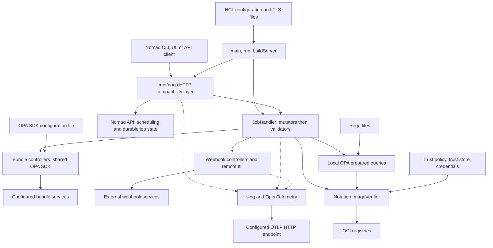

# System architecture and engineering source map

NACP is a **Go reverse proxy in front of the Nomad HTTP API**, not a scheduler or a persistence service. It owns admission-time mutation, validation, and response adaptation. Nomad remains the upstream system responsible for scheduling and durable job state; successfully passing NACP is not a substitute for Nomad accepting a job.

The executable composition root is [`cmd/nacp/nacp.go`](repo://cmd/nacp/nacp.go), which assembles the reusable packages under `pkg/`. The root [`generate.go`](repo://generate.go) is a `package nacp` generation stub, not a second executable. Release builds explicitly target `./cmd/nacp` in [`.goreleaser.yaml`](repo://.goreleaser.yaml#L10-L17).

## Runtime components and boundaries

The components inside NACP evaluate request-scoped jobs, while Nomad, bundle services, webhooks, registries, and telemetry collectors remain external owners.

### CLI/bootstrap and HTTP compatibility

`main`, `buildConfig`, `run`, and `buildServer` own configuration loading, logger and SDK construction, listener/upstream TLS, controller factories, and process shutdown. `-config` selects an HCL file; omission uses defaults, but an explicitly missing file fails. `Config.Validate` checks the listener, upstream URL/TLS pairing, controller names and types, required blocks, and bundle SDK prerequisites before serving. SIGINT/SIGTERM initiate HTTP shutdown with a 30-second deadline; `run` also arranges OPA and telemetry cleanup. See [configuration and deployment](../operations/configuration-and-deployment.md) for startup and operational details.

`newProxyHandler` wraps `httputil.NewSingleHostReverseProxy`. Admission is limited to **PUT/POST** on `/v1/jobs`, `/v1/job/<id>`, `/v1/job/<id>/plan`, and `/v1/validate/job`; other traffic continues through the proxy without admission evaluation. Admission bodies are limited to 32 MiB. `resolveRequestContext`, `applyAdmission`, and `modifyProxyResponse` are the HTTP boundary—not responsibilities of individual policies.

Registration and planning stop on admission errors, currently rendered by `writeError` as HTTP 500. The validation endpoint deliberately forwards the mutated job after validator failures and places those failures in a successful Nomad-compatible validation response; mutator failures still stop it. Warning/error injection applies only to upstream **2xx** responses, preserving Nomad error bodies. Response adapters handle both plain and gzip bodies and repair content lengths. [`buildFullWarningMsg`](repo://cmd/nacp/nacp.go#L374-L383) uses the local compatibility formatter; warnings are written into response `Warnings` fields, not a new NACP response API.

Sources: [proxy and context handling](repo://cmd/nacp/nacp.go#L125-L231), [response adaptation](repo://cmd/nacp/nacp.go#L233-L410), [job handlers and route matching](repo://cmd/nacp/nacp.go#L412-L561).

### Controller chain and extension contract

[`JobHandler`](repo://pkg/admissionctrl/controller.go#L67-L249) depends on `JobMutator` and `JobValidator`, not on OPA, HTTP webhooks, or registries. The factories in the executable select implementations. A new implementation therefore needs both the interface behavior and, if it is to be configurable, configuration validation and factory wiring.

The central invariants are:

- Mutators run in configuration order, passing each returned job to the next. Errors or a nil returned job stop the chain; mutators must tolerate jobs that have not yet been validated.
- Validators inspect the **final mutated job**. Each receives a JSON-deep-copied job, so validator writes cannot change another validator's job or the forwarded job. Validator errors are aggregated rather than stopping at the first validator.
- The shared input is [`types.Payload`](repo://pkg/admissionctrl/types/opa_payload.go): `job` plus optional `context`. Job isolation does **not** imply a deep copy of `RequestContext`; the same request context pointer is passed through the chain.
- Warnings and errors are separate channels. A warning alone does not reject a job; the HTTP adapter decides how each endpoint presents the outcome.

<!-- openwiki: broken internal link [../workflows/job-admission.md] file "../workflows/job-admission.md" does not exist. Fix the href or restore the target, then delete this comment. -->
Detailed request behavior belongs to [job admission](../workflows/job-admission.md).

### Local policies, bundle policies, and remote integrations

The current configured surface is explicit, not an automatically discovered plugin registry:

| Policy boundary | Configured types | Ownership and behavior |
| --- | --- | --- |
| Local Rego | Mutator `opa_json_patch`; validator `opa` | `OpaJsonPatchMutator` and `OpaValidator` retain an `opa.OpaQuery`. `CreateQuery` reads a Rego file and calls `PrepareForEval`; each request evaluates that prepared query with its payload. Results use named `patch`, `errors`, and `warnings` bindings. |
| OPA SDK/bundles | Mutator `opa_bundle_json_patch`; validator `opa_bundle` | `OpaBundleMutator` and `OpaBundleValidator` share the SDK created by `setupOpaSDK`; they call `Decision` with the payload and configured `opa_sdk_rule.path`. The SDK, rather than an NACP HTTP decision client, manages configured bundle services. |
| Webhooks | Mutator `json_patch_webhook`; validator `webhook` | Send the JSON payload to the configured endpoint/method. `remoteutil` owns compatibility context headers, a shared instrumented transport, a 30-second client timeout, and bounded decoding that rejects non-2xx or responses over 10 MiB. Webhook `errors` reject admission. |
| Image verification | Validator `notation`; optional local-Rego builtin | `notation.ImageVerifier` bridges Notation and ORAS registry access. The standalone validator checks Docker task image strings and returns the first verification failure as a **warning**, not a rejection. Local Rego can call `notation_verify_image` and decide whether a false result is an error. |

Local and bundle policies are not interchangeable result contracts. Local queries fail on an empty result set, but absent or wrong-typed binding collections are treated as empty by `OpaQueryResult`. The bundle validator requires an object decision and rejects malformed message collections or non-string entries; missing/null message fields are allowed. Do not generalize the bundle validator's fail-closed contract to all local Rego results.

All three configured patch mutators converge on `jsonpatcher.PatchJob`: patches apply to the serialized **job**, not the enclosing payload or HTTP request. The separate `mutator.WebhookMutator` returns a whole replacement job and has tests, but is **library-only**: `createMutator` has no configuration case for it.

Sources: [factories](repo://cmd/nacp/nacp.go#L789-L892), [local OPA](repo://pkg/admissionctrl/opa/opa.go), [bundle validator](repo://pkg/admissionctrl/validator/opa_bundle_validator.go), [bundle mutator](repo://pkg/admissionctrl/mutator/opa_bundle_json_patch.go), [remote utilities](repo://pkg/admissionctrl/remoteutil/remoteutil.go), [patch application](repo://pkg/admissionctrl/mutator/jsonpatcher/jsonpatcher.go), [standalone Notation validator](repo://pkg/admissionctrl/validator/notation_validator.go).

For policy authoring and integration contracts, use [OPA policies](../integrations/opa-policies.md), [webhooks](../integrations/webhooks.md), and [image verification](../integrations/image-verification.md).

## State ownership and lifecycle

| State | Owner and lifetime | Engineering implication |
| --- | --- | --- |
| Configuration and controller instances | Bootstrap reads HCL/defaults and builds one server's chain. Local prepared queries live with those controller instances. | Local policy files are not reread for each request. There is no NACP configuration-reload API or file-watcher loop here. |
| Bundle policy runtime | One optional `*sdk.OPA` is created before server construction and passed to both factories. | Startup waits for readiness with a 30-second deadline; failure stops the SDK and fails startup. Normal cleanup gives `Stop` a 10-second context. Bundle lifecycle belongs to the SDK configuration, not to a general NACP reload mechanism. |
| Job, identity context, warnings, validation errors | HTTP request context and `types.Payload`. | No NACP durable job store or job-history service is involved. `resolve_token` is ORed across controllers, so any requesting controller enables lookup for actionable requests. Lookup failure aborts; the policy context omits `SecretID` and `ExpirationTTL`. |
| TLS and image trust material | File-backed deployment inputs: TLS certificate/key/CA files, Notation trust-policy document, filesystem X509 trust store, and credential file. | NACP constructs TLS/verifier objects from these inputs. Do not assume a universal hot-reload guarantee for files or library-backed trust stores. |
| Logs, counters, traces | Process-global OTel providers plus `LoggerFactory` and controller instrumentation. | Telemetry is exported, not an admission database. Tests that install providers or exporter environment variables affect process-global state. |

The HTTP server installs the proxy as its handler; it does not define a separate NACP health, storage, or administrative API. See [bootstrap and SDK lifecycle](repo://cmd/nacp/nacp.go#L597-L765), [SDK readiness and stop](repo://cmd/nacp/nacp.go#L922-L982), [sanitized identity model](repo://pkg/config/config.go#L52-L88), and [Notation file/registry ownership](repo://pkg/admissionctrl/notation/notation.go).

### Telemetry boundary

`pkg/logutil.LoggerFactory` fans out `slog` records to configured text/JSON output and the optional `otelslog` bridge. `pkg/otel.SetupOTelSDK` installs enabled logging, metric, and trace providers with OTLP HTTP exporters; it also configures TraceContext/Baggage propagation. Exporters use standard OTel environment configuration.

`otelhttp` instruments the incoming proxy handler and outbound Nomad/webhook transports. `JobHandler` creates admission/controller spans and records named mutator/validator warning/error counters plus mutation counts. The metric definitions are maintained in `pkg/o11y/nacp.yaml` and `common.yaml`; **`pkg/o11y/metric.go` is generated**, with its template at `templates/registry/go/metric.go.j2`. Edit definitions/templates rather than treating generated wrappers as the primary design source. The root generation directive still refers to `./o11y`, whereas current definitions reside under `pkg/o11y`; inspect generation paths before using it blindly.

Sources: [logger factory](repo://pkg/logutil/logutil.go#L100-L143), [OTel providers/exporters](repo://pkg/otel/otel.go#L84-L193), [metric registry](repo://pkg/o11y/nacp.yaml), [generated-code notice](repo://pkg/o11y/metric.go#L1-L11), [generation stub](repo://generate.go).

## Source map by engineering task

This map points to change boundaries and focused tests, rather than reproducing the directory tree.

| Engineering task | Start here | Tests to inspect or extend |
| --- | --- | --- |
| Change CLI defaults, validation, TLS, or shutdown | `buildConfig`, `run`, `buildServer` in `cmd/nacp/nacp.go`; `pkg/config/config.go` | `TestBuildConfig`, `TestConfigValidation`, `TestCreateTlsConfig`, `TestBuildCustomTransport`, `TestRunTerminatesOnSIGINT`; TLS fixture helpers are in `cmd/nacp/tlshelper_test.go`. |
| Change route interception or Nomad response compatibility | `isCreate/isUpdate/isPlan/isValidate`, job handlers, response adapters; `pkg/helper/warning.go` | `cmd/nacp/nacp_test.go`: `TestProxy`, `TestJobUpdateProxy`, `TestAdmissionRouteMatching`, `TestAdmissionControllerErrors`; `pkg/helper/warning_test.go`. |
| Add a controller or change ordering/isolation | `pkg/admissionctrl/controller.go`, `types.Payload`, config validators, `createMutator/createValidator` | `controller_test.go`, especially `TestJobHandler_ValidatorsReceiveIsolatedCopyOfMutatedJob` and `TestJobHandler_RejectsMissingJob`; factory tests in `cmd/nacp/nacp_test.go`. |
| Change local Rego or patch semantics | `pkg/admissionctrl/opa/opa.go`, local controller adapters, `mutator/jsonpatcher` | `opa_test.go` covers empty results and the Notation builtin; `opa_validator_test.go`, `opa_json_patch_test.go`, and `jsonpatcher_test.go` cover adapters and patching. |
| Change bundle loading or decision contracts | `setupOpaSDK/buildOpaSdkWithTimeout`, bundle controller files | `TestBuildOpaSdk`, `TestSetupOpaSDK`, `TestBuildOpaSdkReadinessTimeout`; both bundle-controller test files. `testutil.SetupOpa` supplies a mock HTTP bundle server. |
| Change outbound webhook safety or schema | `remoteutil`, `json_patch_webhook.go`, `webhook_validator.go` | `remoteutil_test.go`, `json_patch_webhook_test.go`, `webhook_validator_test.go`; whole-job library behavior has its own `webhook_mutator_test.go`. |
| Change image trust or registry access | `buildVerifier`, `pkg/admissionctrl/notation/notation.go`, `notation_validator.go` | Mock-driven `notation_validator_test.go` and OPA builtin tests; `notation/notation_test.go` is behind `integration`. |
| Change observability | `pkg/otel`, `pkg/logutil`, controller instrumentation, metric registry/template | `cmd/nacp/nacp_otel_test.go` uses in-memory exporters; `pkg/otel/otel_test.go` includes collector-backed `TestOtlpSetup`; `pkg/logutil/logutil_test.go` covers filtering/fanout configuration. |

Prefer these maintained sources over local `/nacp`, `dist/`, `__debug_bin*`, or coverage `.out` files, which are build/debug outputs listed in [`.gitignore`](repo://.gitignore). Do not infer a runtime component from an artifact's presence.

<!-- openwiki: broken internal link [../testing/safe-changes.md] file "../testing/safe-changes.md" does not exist. Fix the href or restore the target, then delete this comment. -->
<!-- openwiki: broken internal link [../quickstart.md] file "../quickstart.md" does not exist. Fix the href or restore the target, then delete this comment. -->
For execution guidance, see [safe changes and testing](../testing/safe-changes.md). In particular, the Notation integration tag does **not** make every untagged test Docker-free: `TestOtlpSetup` still invokes [`testutil.LaunchCollector`](repo://testutil/otel.go#L53-L102). Use [quickstart](../quickstart.md) for first-run instructions.

## Evolution that explains the current shape

- **Package restructuring:** inspected Git history records the move into `pkg/` (`ca82666` through `ef94b71`), and current executable imports confirm the separation between composition root and reusable code. Old root-level package paths are not today's change locations.
- **OPA SDK/bundle wiring and naming:** history records the bundle validator, patch mutator, SDK setup, and later validator rename from `opa_sdk` to `opa_bundle`. Current factories are authoritative: local OPA still exists, `opa_bundle` is the validator type, while `opa_sdk` and `opa_sdk_rule` remain configuration block names. A reflog experiment titled “Migrate OPA integration to bundles” is not evidence that local Rego was removed.
- **Admission hardening:** the maintained [Unreleased changelog](repo://CHANGELOG.md#L73-L135) explains fixes for route bypasses, validation of the wrong job, identity-resolution fall-through, malformed bundle decisions, and unsafe response rewriting. Current route predicates, isolated validator copies, early returns, and response guards implement these boundaries. These are upgrade-sensitive behavior changes, not merely refactoring.
- **Nomad dependency removal:** the [maintained rationale](repo://update_and_nomad_dep_removal.md#L26-L63) identifies licensing and dependency weight as the drivers for removing the Nomad main module. Current `go.mod` retains `github.com/hashicorp/nomad/api`, not the server module. The MPL-2.0-era warning formatter was copied from Nomad v1.6.3 with notices preserved; TLS test helpers use the standard library instead of importing Nomad internals. Preserve those boundaries when adding helpers. The rationale's reported 510-to-258 module reduction is a historical measurement, not a current graph-size promise.

This summary uses inspected Git history for context, not as proof that every branch experiment shipped. Maintained current-state checks: [executable imports](repo://cmd/nacp/nacp.go#L26-L46), [factories](repo://cmd/nacp/nacp.go#L803-L873), [configuration names](repo://pkg/config/config.go#L143-L160), [`go.mod`](repo://go.mod), and [formatter provenance](repo://pkg/helper/warning.go#L1-L14).
