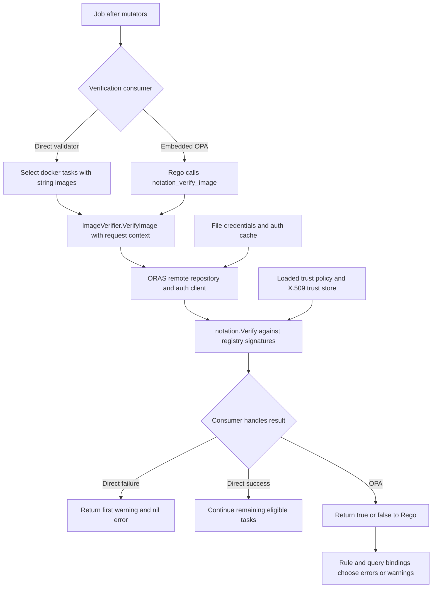

# Notation image verification and policy enforcement

NACP's Notation integration verifies an image reference against signatures in its registry. It supplies a reusable `ImageVerifier` to either a direct job validator or an embedded OPA query. **Verification and admission enforcement are separate decisions.**

> **The direct `NotationValidator` is warning-only, not a strict rejection policy.** It checks tasks whose driver is exactly `docker` and whose `Config["image"]` value is a string. On the first verification failure it returns `[]error{err}, nil`: one warning, no validation error, and no checks of subsequent tasks. Non-Docker tasks and missing/non-string image values are skipped. In contrast, the embedded `notation_verify_image` builtin returns a boolean; Rego must turn `false` into an `errors` result to reject admission.

This distinction holds even when the Notation trust policy uses `signatureVerification.level: strict`. That level configures signature verification, not how NACP handles a failed result. The direct-validator tests explicitly expect a nil error for invalid images. [Direct behavior](repo://pkg/admissionctrl/validator/notation_validator.go#L18-L39), [test assertions](repo://pkg/admissionctrl/validator/notation_validator_test.go#L27-L139).

## Runtime flow and enforcement boundary

<!-- openwiki: broken internal link [../workflows/job-admission.md] file "../workflows/job-admission.md" does not exist. Fix the href or restore the target, then delete this comment. -->
For registration and planning, the admission handler runs mutators before validators, so image validation sees the resulting job. Validators' warning slices and errors are collected separately. A validation error stops registration/planning before forwarding to Nomad; warnings alone do not. The job-validation endpoint instead carries admission validation errors into the successful upstream validation response. See [Job admission](../workflows/job-admission.md) for the full HTTP lifecycle.


*The shared registry verifier checks signatures, while the direct adapter or Rego policy determines the admission consequence.*

Flow sources: [admission ordering and aggregation](repo://pkg/admissionctrl/controller.go#L101-L125), [registry verification](repo://pkg/admissionctrl/notation/notation.go#L88-L119), [OPA builtin](repo://pkg/admissionctrl/opa/opa.go#L23-L61), [HTTP handling](repo://cmd/nacp/nacp.go#L412-L534).

`VerifyImage` creates an ORAS remote repository from the supplied reference, sets its `PlainHTTP` flag and stored client, wraps it in a Notation registry repository, and calls `notation.Verify`. It passes the image unchanged as `ArtifactReference` and the configured `MaxSignatureAttempts`. Repository-construction and verification errors propagate to the consumer. Success returns only nil: the resolved descriptor's digest, size, and media type are debug-logged, not returned to the job or used to rewrite its image.

The implementation registers both **COSE and JWS** signature packages via blank imports. The verifier and auth client are created during controller construction and retained for later calls; each verification constructs a remote repository. There is no NACP verification-result cache in this adapter—the configured cache is an authentication cache. [Implementation](repo://pkg/admissionctrl/notation/notation.go#L9-L119).

## Trust, credentials, and registry access

### Trust policy and X.509 store

`buildVerifier` reads `trust_policy_file` through `LoadTrustPolicyDocument`, which reads the file and JSON-unmarshals a Notation `trustpolicy.Document`. It creates an X.509 trust store with `truststore.NewX509TrustStore(dir.NewSysFS(trust_store_dir))`, then calls `verifier.New(policy, truststore, nil)`. Read/JSON errors and errors from verifier or credential-client construction are returned rather than silently disabling verification. The policy is loaded at construction; this code has no per-request policy-file reload. [Construction](repo://cmd/nacp/nacp.go#L874-L892), [loader and verifier](repo://pkg/admissionctrl/notation/notation.go#L36-L82).

`trust_store_dir` is the **root above `truststore/`**, not the CA certificate directory itself. For a policy entry `ca:valid-trust-store`, the integration test writes a PEM certificate at:

```text
<trust_store_dir>/truststore/x509/ca/valid-trust-store/NotationExample.pem
```

The policy names the store; the filesystem provides its certificates. The test uses that layout with `NewX509TrustStore`. [Test setup](repo://pkg/admissionctrl/notation/notation_test.go#L169-L195), [PEM layout](repo://pkg/admissionctrl/notation/notation_test.go#L432-L453).

The repository demo policy uses version `1.0`, wildcard `registryScopes`, verification level `strict`, store `ca:wabbit-networks.io`, and wildcard `trustedIdentities`. Its setup generates a test certificate with `notation cert generate-test`. **Replace the demo certificate, wildcard trust choices where inappropriate, and user-specific paths with your deployment's trust material and intended scope.** The signing CA trust store is not a substitute for registry HTTPS configuration. [Demo policy](repo://example/notation/trustpolicy.json), [test certificate generation](repo://example/notation/prepare_demo.sh).

### Registry credentials are not Nomad ACL credentials

`credential_store_file` goes to ORAS `credentials.NewFileStore`. NACP constructs an `auth.Client` using:

- `retry.DefaultClient` for HTTP transport;
- `auth.DefaultCache` for authentication caching;
- `credentials.Credential(store)` for credential lookup.

The integration test supplies a Docker-style JSON `auths` map keyed by registry address, with base64-encoded `username:password`, and exercises both unauthenticated and password-protected registries. Configure the credential file explicitly for authenticated deployments; NACP passes the configured string through and does not implement its own Docker-config discovery. NACP needs network access to the referenced registry and access to its artifacts/signatures. [Client construction](repo://pkg/admissionctrl/notation/notation.go#L51-L82), [credential fixture](repo://pkg/admissionctrl/notation/notation_test.go#L121-L178).

This is separate from `resolve_token`. Nomad ACL resolution reads the request's `X-Nomad-Token`, calls Nomad's `/v1/acl/token/self`, and places sanitized token information in the admission context. It does not populate the ORAS credential store. Likewise, this verifier receives an image string and Go context, not a task's Docker auth configuration. [Nomad ACL boundary](repo://cmd/nacp/nacp.go#L85-L124), [request context](repo://cmd/nacp/nacp.go#L187-L217), [sanitization](repo://pkg/config/config.go#L52-L88).

## Configuration: preserve the asymmetric wiring

The effective Notation block locations are deliberately documented as the code currently reads them:

| Consumer | Location read by its factory |
| --- | --- |
| `validator "notation"` | Validator-level `notation { ... }` |
| `validator "opa"` | Validator-level `notation { ... }`, a sibling of `opa_rule` |
| `mutator "opa_json_patch"` | `opa_rule { notation { ... } }` |

**Do not move an embedded OPA validator's block inside `opa_rule` to match the mutator.** The HCL model, defaults, and validation accept/check nested `OpaRule.Notation`, but `createValidator` builds its verifier from `validatorConfig.Notation`. `createMutator` instead reads `mutatorConfig.OpaRule.Notation`. These are not interchangeable. If a Rego module uses `notation_verify_image` with no injected verifier, query preparation fails because the builtin was not registered. This wiring is for embedded OPA; the bundle-backed factory branches do not inject this verifier. [Factories](repo://cmd/nacp/nacp.go#L803-L892), [HCL model and defaults](repo://pkg/config/config.go#L24-L50), [nested validation](repo://pkg/config/config.go#L324-L355), [missing-verifier test](repo://pkg/admissionctrl/opa/opa_test.go#L172-L185).

| Notation setting | Meaning and validation |
| --- | --- |
| `trust_policy_file` | Required policy JSON path. |
| `trust_store_dir` | Required X.509 store filesystem root. |
| `credential_store_file` | Optional ORAS file-store path; passed through to the credential client. |
| `max_sig_attempts` | Signature-attempt limit passed to Notation, not an HTTP retry count. `LoadConfig` changes zero/omitted values to `50`; validation requires a positive value. |
| `repo_plain_http` | Optional boolean, false when omitted. Sets ORAS `PlainHTTP`; reserve `true` for isolated development registries. |

These settings do not install signing keys or sign images. `repo_plain_http = true` is a transport exception, not a fix for missing trust or credentials. See [Configuration and deployment](../operations/configuration-and-deployment.md). [Fields](repo://pkg/config/config.go#L106-L112), [defaulting](repo://pkg/config/config.go#L196-L236), [validation](repo://pkg/config/config.go#L384-L391).

## Strict policy enforcement example

Use the policy in `example/notation/notation.rego`, whose `input.job` shape matches today's `Payload`:

```rego
package image_verification

import future.keywords

errors contains msg if {
	some g, t
	input.job.TaskGroups[g].Tasks[t].Driver == "docker"
	image := input.job.TaskGroups[g].Tasks[t].Config.image

	# check
	not notation_verify_image(image)
	msg := sprintf("TaskGroup %d Task %d image is invalid (image %s)", [g, t, image])
}
```

The matching HCL example binds `errors = data.image_verification.errors` and puts `notation` at validator level. Its `/Users/max/Library/Application Support/notation` paths and `repo_plain_http = true` are **demo values to replace**, not production defaults. [Example HCL](repo://example/notation/notation.conf.hcl), [payload shape](repo://pkg/admissionctrl/types/opa_payload.go).

The builtin is registered only when a verifier exists, with a string-to-boolean declaration. A verification error becomes `false`, not an OPA evaluation error carrying the original diagnostic. The example rule turns that boolean into a task-specific error message; `OpaValidator` converts the query's `errors` binding into a non-nil validation error. Binding only `warnings`, or writing a rule that never emits an error, does not enforce rejection. Missing/wrong-type `errors` bindings read as empty; an entirely empty result set is an evaluation failure. Protect query names and bindings in tests. [Builtin and result extraction](repo://pkg/admissionctrl/opa/opa.go#L23-L93), [validator result handling](repo://pkg/admissionctrl/validator/opa_validator.go#L20-L59).

This rule is not a complete task-schema policy: it targets Docker tasks with an accessible image value. Add and test separate rules if absent images or other drivers must be rejected. See [OPA policies](opa-policies.md).

### Digest references: supported examples, not automatic pinning

The Notation demo obtains `IMAGE` from Docker's `RepoDigests`, submits that reference through `NOMAD_ADDR=http://localhost:6464`, then signs it with `notation sign $IMAGE` and resubmits. The registry integration test also signs and verifies a repository digest. Neither the direct adapter nor the builtin rewrites tags to digests or imposes a digest-only requirement. [Demo commands](repo://example/notation/readme.md#L25-L44), [integration digest extraction](repo://pkg/admissionctrl/notation/notation_test.go#L367-L376).

`misc/hashitalk_secure2024/digest/digest.rego` illustrates a separate format rule requiring the suffix `@sha256:[a-f0-9]{64}$`; it is not signature verification. **Do not deploy those talk policies unchanged:** both its digest and Notation rules read `input.TaskGroups`, while the current payload uses `input.job.TaskGroups`. Their fixtures reflect the old bare-job shape, and the talk's Notation HCL section is commented out. Port the input paths and tests before reuse; use `example/notation` for the current envelope shape. [Digest rule](repo://misc/hashitalk_secure2024/digest/digest.rego), [talk Notation rule](repo://misc/hashitalk_secure2024/notation/notation.rego), [talk configuration](repo://misc/hashitalk_secure2024/nacp.conf.hcl).

## Testing and safe changes

There are two distinct test layers:

- **Fast fake-verifier tests:** `notation_validator_test.go` verifies valid/invalid images, an invalid later task, and non-Docker skipping, asserting warnings and nil errors. `opa_test.go` verifies true/false policy outcomes and query-construction failure when the builtin is used without a verifier. `example/notation/notation_test.rego` mocks the builtin for policy-level checks. These tests exercise adapter and policy semantics without a registry; they do not prove cryptographic trust or registry authentication.
- **Docker-backed integration tests:** `pkg/admissionctrl/notation/notation_test.go` has `//go:build integration`. It launches a registry with Testcontainers, optionally configures htpasswd authentication, builds and pushes an Alpine-based image, generates an RSA self-signed signing certificate, pushes a COSE signature, writes the CA PEM trust store, and verifies the digest under a strict policy. Even `TestLoadTrustPolicyDocument` is in this tagged file. A working Docker environment, image pulls, and registry connectivity are required.

Focused commands from the repository root:

```sh
go test ./pkg/admissionctrl/validator ./pkg/admissionctrl/opa
go test -tags=integration ./pkg/admissionctrl/notation
```

The recent Testcontainers migration uses **split Moby modules**, not the old monolithic Docker SDK imports: `github.com/moby/moby/api`, `github.com/moby/moby/client`, and `github.com/moby/go-archive`. The fixture uses Moby `network.Port`, `network.PortMap`, and client-specific image options. When changing registry setup or upgrading these dependencies, check the integration-tagged build as well as ordinary unit tests; the latter exclude this fixture. [Migration note](repo://update_and_nomad_dep_removal.md#L14-L23), [current dependencies](repo://go.mod#L5-L41), [fixture imports and ports](repo://pkg/admissionctrl/notation/notation_test.go#L19-L40).

<!-- openwiki: broken internal link [../testing/safe-changes.md] file "../testing/safe-changes.md" does not exist. Fix the href or restore the target, then delete this comment. -->
For safe changes, keep warning-only direct behavior explicit, test the Rego error binding, and exercise real credentials/trust separately. See [Safe changes](../testing/safe-changes.md).
