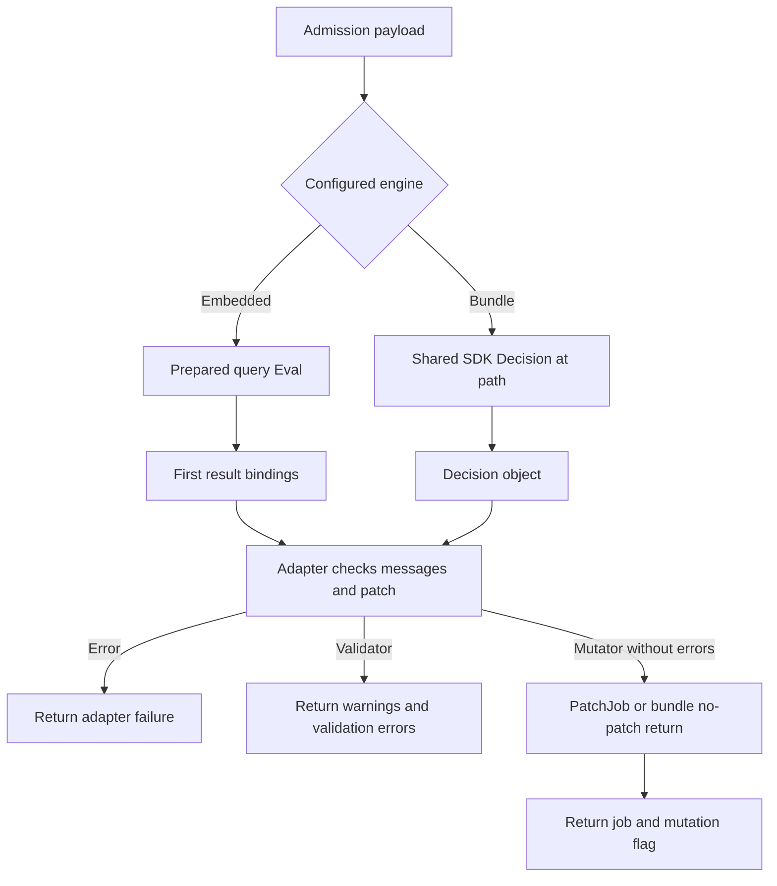

# Authoring and running embedded and bundle OPA policies

NACP has two in-process OPA integration boundaries, each with a validator and a JSON-Patch mutator. **A successful Rego evaluation is not enough: the query bindings or decision object must match the selected adapter.** In particular, missing embedded bindings can silently become empty lists, whereas malformed bundle fields generally fail the adapter.

<!-- openwiki: broken internal link [../workflows/job-admission.md] file "../workflows/job-admission.md" does not exist. Fix the href or restore the target, then delete this comment. -->
All four engines receive a `types.Payload`: read the job at `input.job`, with optional caller information at `input.context`. Mutators run before validators; validators see isolated copies of the final mutated job. See [Job admission](../workflows/job-admission.md) for the shared payload, token resolution, pipeline ordering, and endpoint-specific treatment of errors and warnings. The contracts below describe adapter returns, not a promise that every HTTP endpoint renders them identically. [Payload](repo://pkg/admissionctrl/types/opa_payload.go), [pipeline](repo://pkg/admissionctrl/controller.go#L101-L228).

## 1. Choose an engine

| HCL controller type | Policy loading | Request-time output contract |
|---|---|---|
| `validator "opa"` | One local module and an `opa_rule.query`, prepared when the controller is constructed | First result's bindings named `errors` and optionally `warnings` |
| `mutator "opa_json_patch"` | Same embedded prepared-query engine | First result's `errors`, `warnings`, and `patch` bindings |
| `validator "opa_bundle"` | Shared `sdk.OPA`, configured through `opa_sdk.config_path` | `DecisionOptions.Path` must resolve to an object containing optional `errors` and `warnings` |
| `mutator "opa_bundle_json_patch"` | Same shared SDK | Object containing optional `errors`, `warnings`, and `patch` |

Embedded mode reads `filename` with `os.ReadFile`, adds that module and query to `rego.New`, and calls `PrepareForEval`. Requests reuse the prepared query with `rego.EvalInput(payload)`; this path does not reread the policy file per request. Bundle adapters instead call `opa.Decision(ctx, sdk.DecisionOptions{Input: payload, Path: path})`. They share the SDK passed into the server's controller factories; bundle fetching is not a per-request webhook to a remote decision server. [Embedded engine](repo://pkg/admissionctrl/opa/opa.go#L23-L73), [factory wiring](repo://cmd/nacp/nacp.go#L698-L705), [bundle validator](repo://pkg/admissionctrl/validator/opa_bundle_validator.go#L39-L53).


*Embedded evaluation crosses a prepared-query/bindings boundary; bundle evaluation crosses the SDK Decision/object boundary before the adapter interprets the result.*

### Exact result contracts

An embedded query such as `errors = data.costcenter_meta.errors` binds a name that NACP recognizes. Merely evaluating `data.costcenter_meta`, or binding it as `result`, does **not** make NACP inspect that object's fields. Only `rs[0].Bindings` is read; additional result rows are not aggregated. Prefer a deterministic query returning complete collections.

| Value or condition | Embedded getters | Bundle validator | Bundle mutator |
|---|---|---|---|
| Undefined overall query/decision | Zero result rows cause `no result set returned, maybe the query is wrong?` | SDK decision error, wrapped as `failed to perform policy decision` | Same SDK error handling |
| Overall result is scalar, array, or `null` | No decision-object contract; only named bindings matter | Rejected: `policy yielded an invalid decision value` | Same rejection |
| Recognized binding/key absent | Empty list, **if evaluation returned a row** | Missing message field means no messages | Missing message field means no messages; missing patch returns the input job, `mutated=false` |
| Message field/binding is `null` | Empty list | No messages | No messages |
| Messages are scalar or object rather than a collection | Empty list | Contract error | Contract error |
| Messages are a collection with non-string entries | Entries are not type-checked; formatted using `%s` | Every entry must be a string, including rejection of `null` entries | `null` entries are skipped; other non-string entries are contract errors |
| Patch is `null` or wrong top-level type | Empty list | Not consumed | `null` means no change; non-null, non-array value is a contract error |
| Patch is `[]` | JSON round trip, `mutated=false` | Not consumed | JSON round trip, `mutated=false` |
| Patch collection contains malformed operations | Passed to `PatchJob`; decode/apply/unmarshal can fail | Not consumed | Passed to `PatchJob`; failures are wrapped as `policy yielded patch failed` |

The embedded getters accept only Go `[]interface{}` and otherwise return empty slices. OPA materializes Rego message sets, such as `errors contains msg`, as collections that these adapters can consume. **Author patches as ordered arrays, not sets**, even if a set can cross the Go collection boundary. An undefined field omitted from a bundle package object is just an absent key; selecting that undefined field itself as the decision path is a failed decision. Similarly, adding `warnings = data.policy.warnings` to an embedded query when that document is undefined makes the *whole query* have no result—it is not equivalent to leaving the binding out. [Getters and empty-result handling](repo://pkg/admissionctrl/opa/opa.go#L64-L102), [embedded regression tests](repo://pkg/admissionctrl/opa/opa_test.go#L51-L94), [bundle message parsing](repo://pkg/admissionctrl/validator/opa_bundle_validator.go#L50-L90), [bundle mutation parsing](repo://pkg/admissionctrl/mutator/opa_bundle_json_patch.go#L26-L117).

Message ordering and preservation also differ:

- **Embedded validator:** gathers warnings, aggregates errors, and suffixes each message with `(<controller name>)`. Non-string entries can produce formatting diagnostics rather than a clean contract error.
- **Embedded mutator:** errors stop processing before warnings or patch application. On patch failure it returns no job, `false`, no warnings, and the error.
- **Bundle validator:** parses warnings first. Invalid warnings discard that warning collection and stop processing. Valid warnings survive a subsequent malformed `errors` field or policy errors. Messages are not suffixed with the controller name.
- **Bundle mutator:** parses errors first and stops before warnings or patch if any error is returned. Warning parsing preserves earlier valid warnings if a later entry is malformed. Patch failures retain the parsed warnings at this adapter boundary. Messages are not suffixed with the controller name.

Sources: [embedded validation](repo://pkg/admissionctrl/validator/opa_validator.go#L20-L60), [embedded mutation](repo://pkg/admissionctrl/mutator/opa_json_patch.go#L22-L55), [bundle validation](repo://pkg/admissionctrl/validator/opa_bundle_validator.go#L55-L90), [bundle mutation](repo://pkg/admissionctrl/mutator/opa_bundle_json_patch.go#L41-L117).

## 2. Write a validation rule or mutation

### Validation: require cost-center metadata

This minimal rule is adapted from `example/example1/validators/costcenter_meta.rego`. That fixture also rejects values without the `cccode-` prefix.

```rego
package costcenter_meta

import rego.v1

errors contains msg if {
    not input.job.Meta.costcenter
    msg := "Every job must have a costcenter metadata label"
}
```

A passing job produces an empty error set rather than an undefined `errors` document. Add `warnings contains msg if { ... }` for advisory messages, and bind `warnings` explicitly in embedded mode if you want NACP to consume them. Do not use a bare boolean `allow` decision as the bundle adapter contract. [Cost-center rule](repo://example/example1/validators/costcenter_meta.rego), [bundle scalar rejection test](repo://pkg/admissionctrl/validator/opa_bundle_validator_test.go#L87-L100).

### Mutation: add metadata without destroying existing entries

The repository's hello-world rule handles both absent and null `Meta`, creates its parent first, and only adds `hello` when missing/null:

```rego
package hello_world_meta

import rego.v1

add_meta_ops contains operation if {
    object.get(input.job, "Meta", null) == null
    operation := {"op": "add", "path": "/Meta", "value": {}}
}

add_hello_to_meta_ops contains operation if {
    object.get(input.job, ["Meta", "hello"], null) == null
    operation := {"op": "add", "path": "/Meta/hello", "value": "world"}
}

patch := [operation |
    some ops in [add_meta_ops, add_hello_to_meta_ops]
    operation := ops[_]
]
```

The ordered outer array ensures `/Meta` is created before `/Meta/hello`; each set here contributes at most one operation. Do not rely on set iteration order for dependent operations within a group. This rule leaves an existing non-null `hello` value unchanged, even if it is not `world`. The demo bundle's `foobar` package follows the same pattern for `foo=bar`. [Embedded mutation source](repo://example/example2/mutators/hello_world_meta.rego), [ordering/null fixtures](repo://example/example2/mutators/hello_world_meta_test.rego), [bundle mutation source](repo://example/demo/bundle/foobar/foobar.rego).

### Shared `PatchJob` semantics

Both OPA mutators use `jsonpatcher.PatchJob` for actual patch arrays:

1. JSON-marshal **the `api.Job` only**, not the surrounding payload.
2. JSON-marshal the operation list and decode it with `github.com/evanphx/json-patch`.
3. Apply the operations in array order to the serialized job.
4. Unmarshal the result into a new `api.Job` and return it.

Consequently, JSON Pointer paths start at the **job root**: `/Meta/hello`, not `/job/Meta/hello`. They cannot update `input.context`. Use JSON Pointer escaping for keys containing `/` or `~`, and ensure parent objects exist before adding children. The decoded result must still fit Nomad's Go API model: for example, replacing `Meta` with a number fails unmarshalling. Marshal errors, invalid patch data, failed operations, and invalid result field types return a failure rather than a partial job.

**`mutated` means `len(patch) > 0` after successful application, not semantic inequality.** A nonempty patch that writes the existing value still reports mutation. An empty array still takes the round trip and returns a new job with `false`; the bundle missing/null-patch fast path instead returns the original job without calling `PatchJob`. This distinction matters when interpreting mutation counts or writing idempotence tests. The JSON-Patch webhook integration uses the same helper; see [Webhooks](webhooks.md) for its distinct transport contract. [Patch implementation](repo://pkg/admissionctrl/mutator/jsonpatcher/jsonpatcher.go), [failure tests](repo://pkg/admissionctrl/mutator/jsonpatcher/jsonpatcher_test.go), [bundle fast path](repo://pkg/admissionctrl/mutator/opa_bundle_json_patch.go#L50-L56).

## 3. Wire HCL and load the policies

### Embedded configuration

From the repository root, these controller blocks select the example policies:

```hcl
validator "opa" "costcenter" {
  opa_rule {
    filename = "example/example1/validators/costcenter_meta.rego"
    query = "errors = data.costcenter_meta.errors"
  }
}

mutator "opa_json_patch" "hello_world" {
  opa_rule {
    filename = "example/example2/mutators/hello_world_meta.rego"
    query = "patch = data.hello_world_meta.patch"
  }
}
```

These are controller fragments; use [Configuration and deployment](../operations/configuration-and-deployment.md) for the surrounding server settings. Paths are opened as supplied, so relative policy filenames follow the process working directory. The example directories' own HCL uses `validators/...` or `mutators/...` for running from that directory. Missing files or Rego preparation errors fail controller construction. Config validation requires nonempty `filename` and `query`, known controller types, and unique names within each controller kind. [Example HCL](repo://example/example1/example1.conf.hcl), [mutator HCL](repo://example/example2/example2.conf.hcl), [validation](repo://pkg/config/config.go#L280-L365).

### Bundle configuration and a complete demo trace

The demo's HCL selects **package objects**, not their individual message or patch values:

```hcl
opa_sdk "example" {
  config_path = "/local/opa.yml"
}

validator "opa_bundle" "hello_world" {
  opa_sdk_rule {
    path = "/helloworld"
  }
}

mutator "opa_bundle_json_patch" "foobar_meta" {
  opa_sdk_rule {
    path = "/foobar"
  }
}
```

`/helloworld` returns an object containing the `errors` rules that require `Meta.hello` to equal `world`. `/foobar` returns an object containing the ordered `patch` and helper documents; the adapter ignores unrelated keys. `/foobar/patch` would return an array and be rejected. Neither `opa_sdk "example"` nor the bundle name is a decision path prefix. Both controllers receive the same SDK instance. Bundle configuration requires an `opa_sdk` block and nonempty `opa_sdk_rule.path`; constructors also reject a nil SDK or empty path. These checks do not prove that the configured path exists or returns the right shape. [Demo HCL](repo://example/demo/nacp.conf#L79-L95), [validation package](repo://example/demo/bundle/helloworld/helloworld.rego), [constructors](repo://pkg/admissionctrl/validator/opa_bundle_validator.go#L24-L37), [mutator constructor](repo://pkg/admissionctrl/mutator/opa_bundle_json_patch.go#L120-L132).

Follow the demo artifact end to end:

1. `example/demo/nacp.nomad.hcl` renders `nacp.conf` to `local/nacp.conf.hcl` and `opa.yml` to `local/opa.yml` for the NACP task.
2. `opa.yml` uses Nomad template service discovery for `opabundle`. Its rendered service `nginx` has an `http://<address>:<port>` URL; bundle `demo` names that service and resource `/bundle.tar.gz`. The template directives inside YAML comments still execute. Do not copy the unrendered file into a standalone deployment.
3. The `generatebundle` prestart task renders `helloworld.rego` and `foobar.rego` under `/local/bundle`, then invokes the OPA image with `build -b /local/bundle -o /alloc/data/bundle.tar.gz`.
4. Nginx serves the allocation data directory at `/`, making the archive available at `/bundle.tar.gz`.
5. NACP opens `/local/opa.yml`, passes it and SDK ID `example` to `sdk.New`, waits for readiness, and passes the SDK to the controller factories. At admission time `/foobar` drives mutation and `/helloworld` drives validation. The full demo also includes the embedded hello-world mutator that supplies `hello=world`.

Sources: [Nomad templates and bundle task](repo://example/demo/nacp.nomad.hcl), [SDK YAML](repo://example/demo/opa.yml), [Nginx root](repo://example/demo/default.conf.template), [shared SDK startup](repo://cmd/nacp/nacp.go#L622-L630), [demo embedded mutator](repo://example/demo/nacp.conf#L57-L66).

### Readiness is not a refresh guarantee

`buildOpaSdkWithTimeout` supplies a `Ready` channel to `sdk.New` and waits with a **30-second readiness timeout** in production. A timeout or cancellation stops that SDK and returns a startup error; NACP does not start its HTTP server before successful SDK setup. SDK cleanup uses a fresh background context with a **10-second timeout**. Missing/unreadable config and SDK configuration errors also abort setup. [Lifecycle implementation](repo://cmd/nacp/nacp.go#L922-L975), [startup ordering](repo://cmd/nacp/nacp.go#L622-L646).

This establishes an initialization gate, not continuous proof of policy freshness or decision-path correctness. **SDK/bundle support remains experimental.** Verify subsequent refresh, bad-bundle handling, server outages after readiness, recovery, and acceptable stale-policy/degraded-mode behavior in your own environment; do not infer a production fail-open/fail-closed refresh guarantee from the startup test. [Repository warning](repo://README.md#L151-L159), [readiness test](repo://cmd/nacp/nacp_test.go#L1424-L1441).

### Image-verification extension

Embedded `CreateQuery` conditionally installs `notation_verify_image(string) -> boolean` when supplied an `ImageVerifier`. It returns true when `VerifyImage` returns nil and false on verification failure; Rego must turn false into an `errors` message to enforce rejection. Using the builtin without a verifier fails query preparation. **NACP does not install this custom builtin in its SDK bundle engine.**

Configuration placement is asymmetric in the current factories: `opa` validators read the validator-level `notation` block, while `opa_json_patch` mutators read `opa_rule.notation`. Consult [Notation image verification and policy enforcement](image-verification.md) for exact trust-store, credentials, configuration, and enforcement semantics rather than assuming the direct Notation validator is equivalent to an OPA rejection rule. [Builtin registration](repo://pkg/admissionctrl/opa/opa.go#L23-L61), [factory placement](repo://cmd/nacp/nacp.go#L803-L858), [SDK options](repo://cmd/nacp/nacp.go#L951-L955), [missing-verifier test](repo://pkg/admissionctrl/opa/opa_test.go#L172-L184).

## 4. Verify the result and upgrade safely

Run local Rego fixtures and focused Go adapter tests from the repository root:

```sh
opa test example/example1/validators example/example2/mutators -v
go test ./pkg/admissionctrl/opa ./pkg/admissionctrl/validator ./pkg/admissionctrl/mutator -run 'Opa|JSONPatcher' -count=1
go test ./pkg/admissionctrl/mutator/jsonpatcher -count=1
go test ./cmd/nacp -run 'TestBuildOpaSdk|TestSetupOpaSDK' -count=1
```

Use an OPA CLI compatible with the runtime. These are recommended verification commands, not a record of tests executed for this page.

- **Local Rego:** the cost-center tests cover missing, wrong-prefix, and accepted metadata. The hello-world tests assert the exact operation array for absent/null/empty `Meta`, and an empty patch when the target already exists. Extend these with preservation of unrelated metadata and repeated mutation.
- **Embedded Go:** use `testutil.Filepath(t, "opa/test.rego")` with `CreateQuery`, or construct the validator/mutator against local fixtures in `testdata/opa`. Explicitly test the configured query bindings, empty result sets, misspelled binding names, malformed top-level values, and non-string/null entries; a Rego-only test cannot catch the binding-name contract.
- **Bundle Go:** `testutil.SetupOpa(t, policy)` starts an SDK test HTTP bundle server containing `example.rego`, configures the SDK to fetch it, and registers server/SDK cleanup. Pass that SDK to `NewOpaBundleValidator` or `NewOpaBundleMutator` and evaluate `&types.Payload{Job: job}`. Assert warnings, errors, returned job, and `mutated` independently. Existing tables cover empty packages, nonexistent paths, non-object decisions, malformed messages, invalid patch types/entries, and null patches. Add explicit null-message-entry tests to protect the validator/mutator difference.
- **Application boundary:** test patch failures that decode successfully but cannot unmarshal into `api.Job`, and nonempty patches with no semantic change. Separately exercise the rendered deployment's configured decision paths and refresh/outage behavior; `SetupOpa`'s successful initial fetch is not a degraded-mode test.

<!-- openwiki: broken internal link [../testing/safe-changes.md] file "../testing/safe-changes.md" does not exist. Fix the href or restore the target, then delete this comment. -->
Test references: [Rego validation fixtures](repo://example/example1/validators/costcenter_meta_test.rego), [Rego patch fixtures](repo://example/example2/mutators/hello_world_meta_test.rego), [embedded query tests](repo://pkg/admissionctrl/opa/opa_test.go), [SDK test helper](repo://testutil/testutil.go#L152-L195), [bundle validator table](repo://pkg/admissionctrl/validator/opa_bundle_validator_test.go), [bundle mutator table](repo://pkg/admissionctrl/mutator/opa_bundle_json_patch_test.go). See [Safe changes](../testing/safe-changes.md) for wider regression coverage.

### Naming and compatibility history

History records the validator rename from `opa_sdk` to `opa_bundle` (`892d3269`), but the current configuration deliberately retains **`opa_sdk` for SDK setup and `opa_sdk_rule` for a decision path**. Do not rename those blocks along with the validator type. History also contains a separate `wip/opa-improvements` bundle-migration experiment; it is not evidence that the current embedded engines were removed. The current factory still supports all four types documented here. For the authoritative current contract, see [demo configuration](repo://example/demo/nacp.conf#L79-L95) and [current factory](repo://cmd/nacp/nacp.go#L803-L858).

The runtime uses OPA's `/v1` Go APIs and pins **OPA v1.19.0**. Author v1-compatible Rego (`if`, `contains`, and, where useful for older tooling, `import rego.v1`), and pin compatible bundle-build tooling instead of treating the demo's unversioned OPA image as a compatibility guarantee. The changelog warns that OPA 1.19 makes right-hand-side reads of `:=` stricter: custom policies that previously compiled may now raise `rego_unsafe_var_error`. It also records that bundle validation now fails closed on malformed decisions, and that the earlier payload transition moved job access under `input.job`. Recheck custom rules and their selected decision paths during upgrades, not just bundle download success. [Dependency pin](repo://go.mod#L37-L41), [v1 API use](repo://pkg/admissionctrl/opa/opa.go#L10-L14), [compatibility changes](repo://CHANGELOG.md#L84-L102), [payload transition](repo://CHANGELOG.md#L148-L162).
