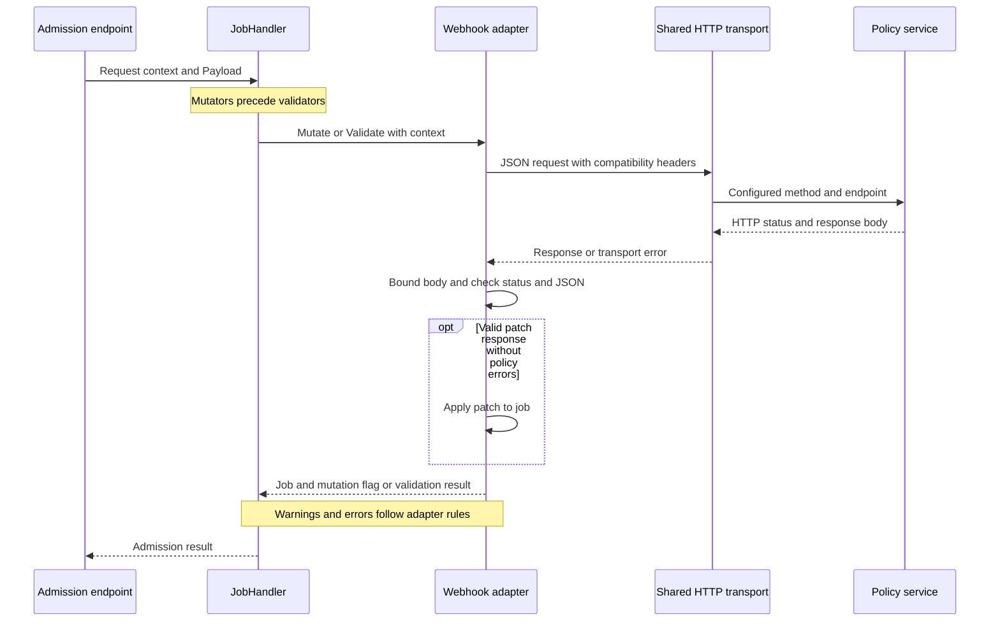

# Webhook policy services and transport contracts

NACP delegates admission decisions to HTTP services through **configured `webhook` validators** and **configured `json_patch_webhook` mutators**. Both receive the shared `types.Payload`, not a Kubernetes AdmissionReview or a Nomad registration request. Mutators run before validators, so a validation service sees the final rendered job. Treat mutation services as capable of receiving invalid jobs.

There is also an exported **full-job `WebhookMutator`**, with its own tests, for Go callers. It is **not selected by CLI `createMutator`** and has no supported HCL mutator type. Its replacement-job response must not be confused with the configured patch response.

<!-- openwiki: broken internal link [../workflows/job-admission.md] file "../workflows/job-admission.md" does not exist. Fix the href or restore the target, then delete this comment. -->
See [job admission](../workflows/job-admission.md) for endpoint routing and [OPA policies](opa-policies.md) for other consumers of the shared admission payload.

## Configure the service boundary

These are controller blocks to add to an NACP configuration:

```hcl
validator "webhook" "job_policy" {
  resolve_token = true
  webhook {
    endpoint = "https://policy.example.com/validate"
    method   = "POST"
  }
}

mutator "json_patch_webhook" "job_defaults" {
  webhook {
    endpoint = "https://policy.example.com/mutate"
    method   = "POST"
  }
}
```

- A `webhook` block is required. The endpoint must parse as an absolute `http` or `https` URL with a nonempty host; relative paths and other schemes are rejected.
- The configured method must be nonblank and accepted by Go's `http.NewRequest`. There is no POST-only allowlist and no configured default method. Use `POST` for the illustrated contract; the adapters use the supplied method and endpoint rather than appending `/validate` or `/mutate`.
- Configuration validation runs when loading configuration and building the server. The two configured adapter constructors also call `remoteutil.ParseEndpoint`, but do not themselves perform the configuration layer's nonblank-method validation. Direct Go callers encounter invalid method syntax during request construction.
- Controller names must be nonblank and unique within each kind. The webhook configuration exposes `endpoint` and `method`, not per-hook timeout, custom headers, or TLS credential fields.

`example/demo/nacp.conf` uses service-discovered HTTP mock endpoints and explicitly marks that setup as useful for testing, not ideal for production. Use trusted HTTPS policy services in production. See [configuration and deployment](../operations/configuration-and-deployment.md).

## Shared request payload and identity

The source of truth is [`types.Payload`](repo://pkg/admissionctrl/types/opa_payload.go):

```go
type Payload struct {
    Job     *api.Job               `json:"job"`
    Context *config.RequestContext `json:"context,omitempty"`
}
```

The body is JSON for the **whole current `api.Job`**, wrapped under lower-case `job`. Job fields retain Nomad API spelling, such as `ID`, `Meta`, and `TaskGroups`. `context` is omitted only when its pointer is nil. The following request shows a body projection for readability; real serialization includes the other job fields, including unset fields according to the API's JSON encoding:

```http
POST /validate HTTP/1.1
Host: policy.example.com
Content-Type: application/json
Accept: application/json
X-Forwarded-For: 192.0.2.10
NACP-Client-IP: 192.0.2.10

{
  "job": {
    "ID": "example",
    "Meta": {"costcenter": "platform"}
  },
  "context": {
    "clientIP": "192.0.2.10",
    "accessorID": "",
    "resolveToken": false
  }
}
```

The mutation request uses the same envelope and headers at its configured endpoint. All three adapters set `Content-Type: application/json` and `Accept: application/json`. `remoteutil.ApplyContextHeaders` adds compatibility headers only for nonempty values:

| Context value | Outgoing headers |
| --- | --- |
| `clientIP` | `X-Forwarded-For` and `NACP-Client-IP` |
| `accessorID` | `NACP-Accessor-ID` |
| Nil context or empty values | No corresponding compatibility headers |

The proxy derives client IP from the first incoming `X-Forwarded-For` entry, otherwise from `RemoteAddr`. This is context, **not independently authenticated identity**; constrain trusted ingress before using it for authorization.

If any configured mutator or validator requests `resolve_token`, token resolution is enabled for the admission pipeline, not only that one hook. For actionable admission requests, the proxy uses `X-Nomad-Token` to query Nomad's `/v1/acl/token/self`. It then sets `accessorID` and optional `tokenInfo` using `config.SanitizeACLToken`. `tokenInfo` includes identity, policy/role links, global flag, timestamps, and indexes, but has **no `SecretID` field**. A missing token can leave `tokenInfo` absent even when `resolveToken` is true.

The webhook adapters construct fresh requests and do not forward the incoming `X-Nomad-Token`. This sanitizes ACL context, **not job contents**: task environment values, templates, and any other sensitive data present in the job are still part of the payload. HTTPS does not make an arbitrary recipient safe. Restrict endpoint ownership, network access, and policy-service logging accordingly. Webhook clients use the shared default transport, not the separately configured Nomad backend TLS transport.

## Request and response flow


This sequence shows one webhook invocation within the mutation-then-validation pipeline, with endpoint-specific HTTP handling left to the proxy.

Mutators run sequentially with the previous result as the next job and stop on an error. Validators receive copies of the final job, run sequentially, and accumulate errors rather than stopping at the first validator. The original request context is carried through controller spans into `http.NewRequestWithContext`, so cancellation and deadlines can terminate outgoing work.

## Validation response

Return a successful HTTP response with a JSON object containing string arrays:

```http
HTTP/1.1 200 OK
Content-Type: application/json

{
  "errors": [],
  "warnings": ["costcenter will become mandatory"]
}
```

`WebhookValidator.Validate` returns `(warnings []error, err error)`:

- Empty or omitted arrays, including `{}`, mean no objections.
- With no errors, warning strings become returned `error` values and `err` is nil.
- A nonempty `errors` array becomes a `multierror.Error`. **If warnings and errors coexist, warnings are discarded** because the error branch returns before warning conversion.

For example, `{"errors":["missing costcenter"],"warnings":["deprecated image"]}` returns an aggregate error containing `missing costcenter` and nil warnings. Return policy denials in the JSON `errors` array on a 2xx response if you want those messages interpreted as policy results; a non-2xx body is not decoded as a policy decision.

## JSON-Patch mutation response

The configured `json_patch_webhook` expects a response envelope, **not a bare patch array**:

```http
HTTP/1.1 200 OK
Content-Type: application/json

{
  "patch": [
    {"op": "add", "path": "/Meta", "value": {"costcenter": "platform"}}
  ],
  "warnings": ["default costcenter applied"],
  "errors": []
}
```

Patch paths address the serialized **job itself**, so `/Meta` is correct, not `/job/Meta`. This example replaces or creates the whole `Meta` member; preserve existing keys when that is required by policy.

`JsonPatchWebhookMutator.Mutate` returns `(job, mutated, warnings, err)`:

1. Decode the envelope and convert warning strings.
2. **Reject nonempty `errors` before applying any patch.** The adapter returns `(nil, false, warnings, policyErr)`, aggregating error strings with `multierror`.
3. Otherwise, `jsonpatcher.PatchJob` marshals the job and operations, decodes and applies the patch with `evanphx/json-patch`, then unmarshals the result into `api.Job`.
4. Success returns the patched job, warnings, and nil error. `mutated` means the decoded patch has at least one operation, not that a semantic difference was proved. `{}` or an empty patch is a no-op with `mutated == false`.

**Regression guard:** JSON-Patch webhook policy errors now reject mutations instead of being ignored. Keep the `policy errors reject the mutation` case in `TestJsonPatchMutator`. Although the adapter preserves warnings alongside a policy error, `AdmissionMutators` returns nil warnings on failure, so those warnings are not promised to the client.

Patch decoding, application, or result-to-`api.Job` decoding failures return `(nil, false, nil, err)`; even already-converted warnings are lost on this branch.

## Full-job adapter: Go extension only

`NewWebhookMutator(name, endpoint *url.URL, method)` constructs the exported full-job adapter without the configured constructors' endpoint parser. Go integrators must supply a usable endpoint and method. It sends the same `Payload`, but decodes the response directly into an `api.Job`, for example:

```json
{
  "ID": "example",
  "Meta": {"costcenter": "platform"}
}
```

This is a **replacement job**, not a merge or a `{"job": ...}` envelope. The service must return every job field it intends to preserve. Success returns `(newJob, !reflect.DeepEqual(newJob, payload.Job), nil, nil)`. There is no warnings/errors policy envelope. Transport or decoding failures return `(nil, false, nil, err)`. Do not add `mutator "webhook"` to HCL: `createMutator` does not support it.

## Transport limits and failure boundaries

All adapters use [`remoteutil`](repo://pkg/admissionctrl/remoteutil/remoteutil.go), which centralizes these contracts:

| Boundary | Behavior |
| --- | --- |
| Client lifecycle | Each invocation creates an `http.Client` using the same package-level instrumented transport over `http.DefaultTransport`, preserving shared transport pooling. |
| Tracing | `otelhttp` wraps the transport and installs `otelhttptrace` client tracing under the transport span. See [observability](../operations/observability.md). |
| Time budget | Client timeout is **30 seconds**. Request context cancellation or an earlier deadline can end the call sooner. This is distinct from the Nomad proxy timeout. |
| Transport errors | Request construction, marshaling, and `Client.Do` errors are returned by the adapter; there is no adapter-level retry loop. |
| Body lifecycle | Once `Do` succeeds, each adapter defers response-body closure, including status, size, decoding, and policy-error paths. |
| Response size | `DecodeJSONResponse` reads at most **10 MiB + 1 byte** and rejects anything above **10 MiB** (`10 << 20`). Read errors are returned first, then oversize errors. |
| HTTP status | After reading and bounding the body, the decoder rejects status outside **200–299**. This applies to the response delivered by Go's client; no custom redirect policy is installed. |
| JSON | `json.Unmarshal` must succeed after the status check. Empty bodies, malformed JSON, trailing non-whitespace data, and incompatible field types fail. Response `Content-Type` is not checked and unknown object fields are not rejected. A 204 empty response is therefore not a successful policy response. |

For these common failures, the validator returns `(nil, err)` and both mutators return `(nil, false, nil, err)`. These are **adapter failures**, not a universal statement about the HTTP response NACP sends to the Nomad client:

- Registration and planning propagate admission errors to the proxy's error path, which responds with HTTP 500 without forwarding the request.
- Validation returns immediately on mutation errors, but stores validator errors in request context and forwards the validation request. On a successful Nomad validation response, NACP incorporates those errors into `ValidationErrors` and `Error`; non-success upstream responses are not rewritten this way.

<!-- openwiki: broken internal link [../workflows/job-admission.md] file "../workflows/job-admission.md" does not exist. Fix the href or restore the target, then delete this comment. -->
Use [job admission](../workflows/job-admission.md) for the endpoint-specific flow and response rewriting rather than assuming every webhook error produces an immediate HTTP rejection.

## Test and change the contract safely

Use local `httptest` servers rather than external policy infrastructure:

- [`webhook_validator_test.go`](repo://pkg/admissionctrl/validator/webhook_validator_test.go): payload decoding, endpoint/method and headers, empty results, errors, warnings, and non-success status.
- [`json_patch_webhook_test.go`](repo://pkg/admissionctrl/mutator/json_patch_webhook_test.go): no-op and real patches, faulty operations, warnings, context/JSON headers, non-success status, and the policy-error rejection regression.
- [`webhook_mutator_test.go`](repo://pkg/admissionctrl/mutator/webhook_mutator_test.go): full-job replacement and compatibility headers for the Go-only adapter.
- [`remoteutil_test.go`](repo://pkg/admissionctrl/remoteutil/remoteutil_test.go): endpoint parsing, compatibility headers, instrumented client type, size bound, status handling, malformed JSON, and response read errors.

For changes, add focused tests for cancellation, body closure, mixed errors/warnings, and full payload preservation where relevant; do not infer that the existing happy-path tests cover those cases. The Java `example/demo/MockHooks.java` is only a smoke-test service: `/validate` returns empty warnings/errors and `/mutate` also returns an empty patch.

```sh
go test ./pkg/admissionctrl/remoteutil ./pkg/admissionctrl/validator ./pkg/admissionctrl/mutator/...
go test ./pkg/config ./cmd/nacp
```

<!-- openwiki: broken internal link [../testing/safe-changes.md] file "../testing/safe-changes.md" does not exist. Fix the href or restore the target, then delete this comment. -->
See [safe changes](../testing/safe-changes.md) for the broader validation workflow.
