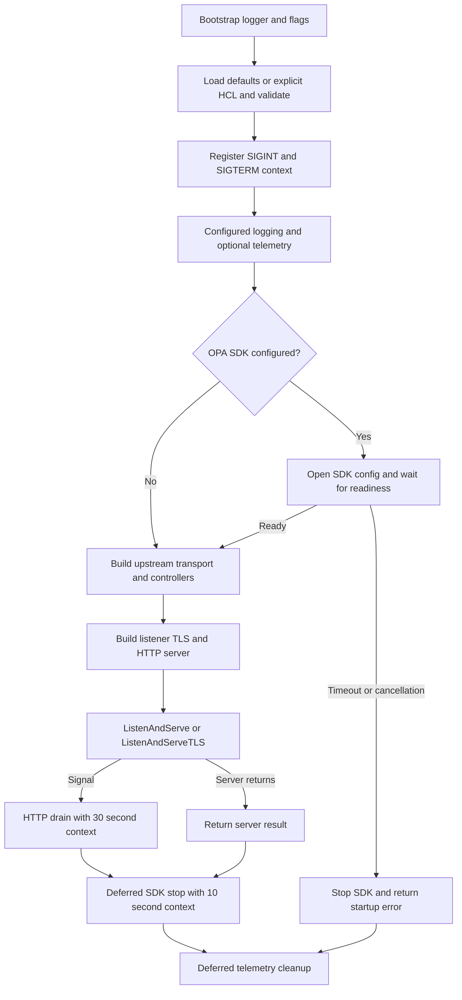

# Configuration, deployment, and lifecycle runbook

NACP belongs on the Nomad control-plane boundary, not on an untrusted public network. It intercepts selected job admission operations and proxies other requests to Nomad. A running process with the default configuration has **no configured mutators or validators**; successful startup alone does not prove policy enforcement.

<!-- openwiki: broken internal link [/openwiki/workflows/job-admission.md] file "/openwiki/workflows/job-admission.md" does not exist. Fix the href or restore the target, then delete this comment. -->
For request semantics see [Job admission](/openwiki/workflows/job-admission.md); for component boundaries see the [System map](/openwiki/architecture/system-map.md).

## Configuration contract

Start with an explicit deployment configuration:

```sh
/nacp -bootstrap-json-logger -config /etc/nacp/nacp.hcl
```

`-config` is optional. Omitting it uses built-in defaults and logs the working directory; it does not search for a conventional configuration file. An explicitly supplied missing, unreadable, or invalid file fails startup instead of falling back to defaults. The bootstrap logger writes info-level text to stdout, or JSON with `-bootstrap-json-logger`, before configured logging takes over.

`bind` and `port` are **top-level attributes**, not a `server` block. This is a minimal local-only example, not an enforcing production policy:

```hcl
bind = "127.0.0.1"
port = 6464

nomad {
  address = "http://localhost:4646"
}
```

HCL is decoded over `DefaultConfig()`. Empty HCL therefore retains these defaults:

| Setting | Default |
| --- | --- |
| Listener | `bind = "0.0.0.0"`, `port = 6464`, no TLS |
| Upstream | `nomad.address = "http://localhost:4646"`, no custom TLS |
| Controllers and SDK | Empty mutator/validator lists, no `opa_sdk` |
| Logging | `telemetry.logging.level = "info"`; text on stdout, JSON disabled, JSON destination defaults to stdout |
| Exported telemetry | OTEL logging, metrics, and tracing disabled |
| Controller identity lookup | `resolve_token = false` |
| Notation | HCL loading turns omitted or zero `max_sig_attempts` into `50`, including nested `opa_rule` notation blocks |

The decoder has an empty HCL evaluation context: do not expect Nomad interpolation functions or environment expansion. NACP passes rule filenames, SDK configuration paths, TLS paths, and trust-policy paths directly to filesystem APIs. **Relative paths are relative to the process working directory, not to the HCL file.** Prefer absolute paths in scheduled deployments.

### Controller blocks and validation boundaries

Each controller has two labels: its supported type and a nonblank name. Names must be unique **within each kind**; a mutator and a validator may share a name. Construction preserves order within each list; admission runs mutators before validators.

| Controller declaration | Required configuration |
| --- | --- |
| `mutator "opa_json_patch" "name"` | `opa_rule` with nonblank `filename` and `query` |
| `mutator "json_patch_webhook" "name"` | `webhook` with absolute HTTP(S) `endpoint` and nonblank, syntactically valid `method` |
| `mutator "opa_bundle_json_patch" "name"` | `opa_sdk_rule` with nonblank `path`, plus shared `opa_sdk` |
| `validator "opa" "name"` | `opa_rule` with nonblank `filename` and `query` |
| `validator "webhook" "name"` | `webhook` with `endpoint` and `method` as above |
| `validator "opa_bundle" "name"` | `opa_sdk_rule` with nonblank `path`, plus shared `opa_sdk` |
| `validator "notation" "name"` | `notation` with `trust_policy_file`, `trust_store_dir`, and positive effective `max_sig_attempts` |

A shared SDK is declared as `opa_sdk "id" { config_path = "/etc/nacp/opa.yml" }`; its ID and configuration path must be nonblank. The path inside `opa_sdk_rule` is an OPA decision path, not a filesystem path. See [OPA policies](/openwiki/integrations/opa-policies.md), [Webhooks](/openwiki/integrations/webhooks.md), and [Image verification](/openwiki/integrations/image-verification.md) for contracts and Notation attachment details.

`LoadConfig` validates after decoding and applying defaults; `buildServer` calls `Validate` again. Checks include port range `1..65535`, nonblank bind, a nonnil effective Nomad configuration with an absolute HTTP(S) URL, listener cert/key presence, upstream cert/key pairing, and the controller requirements above. Omitting the HCL `nomad` block still retains the default Nomad configuration. Slog output destinations are checked against `stdout` and `stderr` by the loader.

This is **not exhaustive preflight validation**. A nonblank bind is not checked for resolvability or availability; URL checks do not prove connectivity; policy, certificate, credential, and trust-store contents can fail later during construction or use. An unsupported logging level is not rejected by `Validate`: logger construction panics with `unknown level`. Use `debug`, `info`, `warn`, or `error` (case-insensitive). Passing HCL validation does not prove that every extra, mismatched controller block will be consumed.

## Secure placement and TLS

Restrict both NACP and Nomad network access. Clients subject to admission must not also have a direct path to submit jobs to Nomad: the proxy cannot enforce policy on requests that bypass it. Keep Nomad ACLs enabled as an independent upstream authorization boundary. Treat webhooks and OPA bundle servers as trusted policy infrastructure, and keep TLS keys, registry credentials, OPA credentials, and Nomad tokens outside source control.

Sanitize or replace `X-Forwarded-For` at the trusted edge and prevent clients from bypassing that edge. NACP takes the trimmed **first** comma-separated value without validating the sender's trustworthiness. With no header it uses the host from `RemoteAddr`, or the original string if parsing fails. That value reaches policy context and webhook client-IP headers; it is not authenticated identity by itself.

### Listener versus upstream TLS

These are separate TLS connections and separate trust settings:

| Boundary | Configuration and behavior |
| --- | --- |
| Client → NACP | Top-level `tls` supplies listener `cert_file` and `key_file`. Without a CA file, this is server-authenticated TLS only. With nonempty `ca_file`, the listener requires and verifies client certificates by default. `no_client_cert = true` disables that client-certificate requirement; it does not disable listener encryption. |
| NACP → Nomad | Use an `https://` Nomad address. Nested `nomad.tls` sets `ca_file` for server trust, optional paired `cert_file`/`key_file` for NACP's client identity, and `insecure_skip_verify`. This transport is also used for ACL token lookup. |

Both the listener and the explicit upstream TLS configuration set a TLS 1.2 minimum. Supplied CA files must be readable PEM containing at least one valid certificate; invalid PEM is rejected. A custom upstream CA pool replaces, rather than augments, system roots. With no custom CA, upstream verification uses system roots. CA-only, client-certificate, and system-root upstream configurations are supported.

The HCL schema marks `ca_file`, `cert_file`, and `key_file` as required attributes **inside either TLS block**, even though some may be empty at runtime. For example, CA-only upstream TLS is:

```hcl
nomad {
  address = "https://nomad.internal:4646"
  tls {
    ca_file   = "/etc/nacp/tls/nomad-ca.pem"
    cert_file = ""
    key_file  = ""
  }
}
```

Do not use `insecure_skip_verify` to repair production certificate failures: it disables upstream certificate/hostname verification, not listener client authentication. Fix the trust chain and the address/certificate names instead. Likewise, reserve Notation's `repo_plain_http` for controlled development.

Sources: [configuration schema and validation](repo://pkg/config/config.go), [TLS construction](repo://cmd/nacp/nacp.go#L672-L787), [upstream TLS](repo://cmd/nacp/nacp.go#L894-L921), [security boundary](repo://SECURITY.md).

## Delivery, mounts, and resources

Tag pushes trigger the release workflow, which imports a GPG key, logs into GHCR, and runs GoReleaser. The release configuration builds `./cmd/nacp` with `CGO_ENABLED=0` for Linux, Windows, and macOS; it produces tar.gz archives (ZIP for Windows), `checksums.txt`, and a detached signature of the checksum artifact. Container tags are `ghcr.io/mxab/nacp:latest` and the release tag. Pin a tested version or digest rather than relying on a moving `latest` tag.

The two Dockerfiles are not interchangeable:

- **`Dockerfile` consumes a prebuilt `nacp` binary.** Its runtime is `scratch`, containing `/nacp` and the CA bundle copied from an Alpine certificate stage. It runs as numeric UID/GID `10001:10001`, with `/nacp` as entrypoint. There is no shell or package manager for in-container troubleshooting. A manual image build needs a suitable static Linux binary in the build context.
- **`dev.Dockerfile` compiles source.** It runs `go build -o nacp ./cmd/nacp` with CGO disabled in a Go stage, then copies the result into Ubuntu and runs as `nobody`. It is a development path, not the release image layout.

Mount HCL, Rego files, SDK configuration, TLS certificates/keys, and Notation trust policy/store/credentials at the paths referenced by the configuration. Ensure UID/GID `10001:10001` can read files and traverse parent directories; prefer narrowly permissioned read-only mounts. The built-in CA bundle does not contain your private CA or Notation signing trust material. Use host-side or separate diagnostic tooling for the scratch image.

`example/demo/nacp.nomad.hcl` is a **Nomad job specification**, not input for `-config`. Its task launches `/nacp -config /local/nacp.conf.hcl` and templates configuration, Rego, and `opa.yml` into the allocation. The source `nacp.conf` contains `{{ env ... }}` and `{{ range nomadService ... }}` expressions that Nomad must render first. Inspect the rendered result: multiple discovered instances can repeat fixed controller names and now fail duplicate-name validation. The demo's NACP service registration has no health check; do not confuse checks on other demo services with NACP readiness.

CPU and memory budgets belong to the container runtime or scheduler, not the NACP HCL schema. The demo's `cpu = 1024` / `memory = 1024` block belongs to its monitoring task, not NACP. Size NACP from representative concurrent admission traffic, policy complexity, and remote dependency latency. The body limit below is not a process-memory limit: job decoding, patching, and isolated validator copies require additional allocations.

Sources: [release workflow](repo://.github/workflows/release.yml), [GoReleaser](repo://.goreleaser.yaml), [release image](repo://Dockerfile), [development image](repo://dev.Dockerfile), [Nomad demo](repo://example/demo/nacp.nomad.hcl), [rendered-config template](repo://example/demo/nacp.conf).

## Lifecycle and readiness


The configured OPA SDK gates listener startup, while HTTP drain, SDK stop, and telemetry cleanup have separate owners.

`run` constructs one shared OPA SDK before constructing controllers and the server. Its readiness channel must close before startup continues. SDK creation/configuration failures return errors; a readiness timeout or cancellation stops the SDK before returning failure. Controller construction then loads/prepares local Rego, constructs configured verifiers, and creates the proxy handler. TLS listener certificates are loaded by `ListenAndServeTLS`; the “Starting NACP” log occurs before the listen call succeeds.

There is no dedicated NACP readiness endpoint in the installed handler, and no live HCL reload path. Treat HCL, local policy, and TLS changes as restart deployments. SDK-managed bundle behavior is separate from HCL reload. Check socket availability plus a controlled request through the proxy and a representative policy canary; a passthrough Nomad response alone does not prove controller health. See [Observability](/openwiki/operations/observability.md) for telemetry configuration and signals.

### Limits and timeout ownership

These values are set in code, not exposed as NACP HCL tuning fields.

| Owner | Value | Scope |
| --- | --- | --- |
| Admission reader | 32 MiB | Request bodies on recognized register, plan, and validate routes only |
| Webhook response decoder | 10 MiB | Maximum response body before JSON decoding |
| Webhook HTTP client | 30 s | Each webhook request, also carrying the incoming request context |
| ACL self-lookup HTTP client | 30 s | `GET /v1/acl/token/self`, also carrying the request context |
| HTTP server | 15 s / 310 s / 310 s / 120 s | `ReadHeaderTimeout` / `ReadTimeout` / `WriteTimeout` / `IdleTimeout` |
| Nomad transport | 310 s | Dial timeout, dialer keepalive setting, TLS handshake timeout; **not** a total upstream-response deadline |
| OPA startup readiness | 30 s | Readiness context derived from the signal context; passed to the readiness wait, not as `sdk.New`'s context |
| HTTP shutdown | 30 s | Fresh background-derived context for `server.Shutdown` after SIGINT/SIGTERM |
| OPA stop | 10 s | Separate fresh context for each `opaSDK.Stop`, including readiness-failure cleanup |
| Telemetry shutdown | No NACP deadline added | Deferred `otelShutdown(context.Background())`; exporter/provider behavior is separate |

The reverse proxy does not install an overall `http.Client.Timeout` for Nomad forwarding. Do not interpret server write deadlines as cancellation budgets for every admission dependency. On shutdown, signal notifications are stopped, HTTP drain runs first, then deferred SDK stop, then deferred telemetry cleanup. `http.ErrServerClosed` is normal; drain failures propagate, and telemetry cleanup errors are joined to the returned error. Startup/runtime errors reported by `main` exit with status 1.

Give the supervisor a termination grace period that covers drain **and** subsequent cleanup, not just 30 seconds. A long-running request may exceed the shorter drain budget even though the server's normal read/write settings allow 310 seconds.

Sources: [bootstrap and run](repo://cmd/nacp/nacp.go#L576-L745), [SDK lifetime](repo://cmd/nacp/nacp.go#L922-L982), [request limits and token lookup](repo://cmd/nacp/nacp.go#L60-L218), [webhook limits](repo://pkg/admissionctrl/remoteutil/remoteutil.go#L45-L85), [telemetry cleanup](repo://pkg/otel/otel.go#L25-L50).

## Symptom-to-source runbook

First distinguish **no listener**, **admission rejection**, and **upstream failure**. Preserve the effective HCL and rendered paths for diagnosis, but redact tokens, credentials, and sensitive job contents.

| Symptom | Source and interpretation | Operator action |
| --- | --- | --- |
| `Error loading config` / `invalid config` | `buildConfig`, `LoadConfig`, `Validate`; explicit bad paths do not fall back | Check the exact `-config` argument, process filesystem, top-level bind/port, required blocks, URL schemes, and duplicate names. For `unknown level` panic, correct the logging level. |
| `failed to create mutators` / `failed to create validators` | Controller constructors; `opa.CreateQuery` reads and prepares Rego, `buildVerifier` loads trust policy | Verify paths and permissions as the runtime UID, then Rego syntax/query and trust-policy JSON. File existence is not established by structural HCL validation. |
| Trust or registry failure during admission | `notation.NewImageVerifier` / `VerifyImage`; a constructed trust-store wrapper does not prove every trust file works | Check trust-store layout, signing certificates, registry access, and credential mounts. Use [Image verification](/openwiki/integrations/image-verification.md), not TLS bypass flags. |
| `OPA SDK did not become ready in time` | `buildOpaSdkWithTimeout`; listener has not started | Check SDK file, bundle URL/resource, service reachability, authentication, and CA trust. Allow startup dependency time; SDK stop cleanup may follow the 30 s readiness wait. |
| `Resolving token failed` | `resolveTokenAccessor` / `resolveRequestContext` | Any controller's `resolve_token = true` enables lookup for actionable admission requests. Check Nomad connectivity/TLS, `X-Nomad-Token`, and `/v1/acl/token/self` status/JSON. A lookup failure returns HTTP 500 and stops admission and proxying. An empty token skips lookup and leaves identity empty. |
| Webhook timeout, unexpected HTTP status, oversize or undecodable response | `remoteutil.NewInstrumentedClient`, `DecodeJSONResponse` | Check endpoint/method, network and CA trust, 30 s latency, 2xx status, JSON contract, and 10 MiB limit. Policy `errors` are failures, including JSON-patch mutator errors. See [Webhooks](/openwiki/integrations/webhooks.md). |
| Listener TLS failure or `failed to create custom transport` | `createTlsConfig`, `buildTlsConfig`, `ListenAndServeTLS` | Identify which TLS leg failed. Check PEM, key pairing, readable mounts, hostname/SANs, expiry, and required client certificate. Fix trust rather than disabling verification. |
| `Error applying admission controllers` or body-too-large error | Admission body decoding/controller pipeline | Check the 32 MiB actionable-body cap and controller logs. `writeError` uses HTTP 500, so do not assume a size failure returns 413. Register/plan stop on admission errors; validate requests can report validator errors in Nomad's successful validation response. |
| Nomad error body reaches client, or `Preparing response failed` | Reverse proxy / response modification | Non-2xx Nomad responses are not rewritten for warning/error injection. Investigate upstream status/body first. A successful response that cannot be decoded during injection is a separate proxy-response failure. |
| `failed to shut down server`, delayed exit, or exit after `NACP stopped` | `run` and deferred cleanup | Check in-flight requests, the 30 s drain budget, subsequent SDK/telemetry cleanup, and supervisor kill timing. `NACP stopped` precedes deferred cleanup and is not proof of completed telemetry shutdown. |

## Upgrade and verification checklist

The current [Unreleased changelog](repo://CHANGELOG.md#L64-L146) describes behavior changes; do not infer that all are present in a previously published tag.

- **Route matching:** update and plan paths now match any non-slash job ID, including digits, underscores, dots, and uppercase letters. Existing jobs that previously bypassed admission may now mutate or fail. Admission still applies only to PUT/POST on the recognized routes.
- **Identity input:** `tokenInfo` omits `SecretID` and `ExpirationTTL`; `ResolveToken` now reflects requested resolution. Update policies or webhooks that depended on removed fields. Failed lookups now abort rather than continuing without identity.
- **Bundle contract:** validators require an object decision. Non-null `errors` and `warnings` must be string lists; absent/null fields are accepted. Scalar, undefined, or malformed decisions must not be treated as successful validation. See [OPA policies](/openwiki/integrations/opa-policies.md).
- **Stricter startup and webhook behavior:** formerly tolerated missing blocks, duplicate names, bad URLs, or missing explicit config paths can prevent startup. JSON-patch webhook `errors`, non-2xx responses, timeouts, and response limits are now enforced.
- **Policy execution and tooling:** validators see isolated copies of the final mutated job. Recheck custom Rego against the changelog's OPA 1.19 assignment-safety changes. Migrate old `log_level` to `telemetry.logging.level` and recheck log consumers after the slog/OTEL changes.
- **Container permissions and trust:** recheck mounted-file access for UID/GID `10001:10001`; the release image now includes system CAs, but private trust still needs provisioning.

<!-- openwiki: broken internal link [/openwiki/testing/safe-changes.md] file "/openwiki/testing/safe-changes.md" does not exist. Fix the href or restore the target, then delete this comment. -->
<!-- openwiki: broken internal link [/openwiki/quickstart.md] file "/openwiki/quickstart.md" does not exist. Fix the href or restore the target, then delete this comment. -->
Useful regression anchors are `TestBuildConfig`, `TestAdmissionRouteMatching`, `TestBuildOpaSdk`, `TestBuildOpaSdkMissingFile`, `TestSetupOpaSDK`, and `TestBuildOpaSdkReadinessTimeout` in `cmd/nacp/nacp_test.go`; `TestConfigValidation`, `TestLoadConfigDefaults`, and `TestSanitizeACLTokenExcludesSecretID` in `pkg/config/config_test.go`; and `TestCreateTlsConfig` / `TestBuildCustomTransport` using generated CA/leaf fixtures in `tlshelper_test.go`. `TestRunTerminatesOnSIGINT` exercises shutdown with default and enabled telemetry configurations; it is not evidence of a SIGTERM-specific test or of every drain failure case. Follow [Safe changes](/openwiki/testing/safe-changes.md) for broader testing and [Quickstart](/openwiki/quickstart.md) for the first local deployment.
