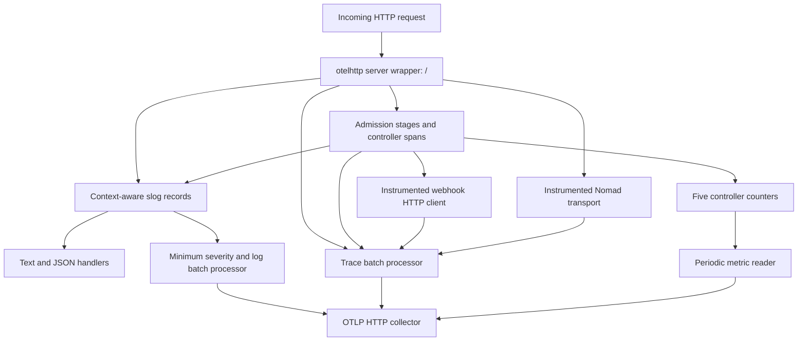

# Logs, metrics, and request tracing

<!-- openwiki: broken internal link [/openwiki/workflows/job-admission.md] file "/openwiki/workflows/job-admission.md" does not exist. Fix the href or restore the target, then delete this comment. -->
NACP observes admission through `log/slog`, five controller counters, and OpenTelemetry spans. **Telemetry is not the admission decision.** Controller return values and the HTTP response path determine the result; changing a log threshold does not turn a policy error into a warning. Register and plan abort on admission errors, while `/v1/validate/job` carries validator errors forward for inclusion in the validation response. Inspect the client response as well as telemetry. See [Job admission](/openwiki/workflows/job-admission.md) for enforcement semantics. [Implementation](repo://cmd/nacp/nacp.go#L412-L533)

## Enable the signals you need

Defaults from `DefaultConfig` are:

| Setting | Default | Meaning |
| --- | --- | --- |
| `telemetry.logging.level` | `"info"` | Shared local-log and OTLP-log threshold |
| `telemetry.logging.slog.text` / `text_out` | `true` / `"stdout"` | Local text logs |
| `telemetry.logging.slog.json` / `json_out` | `false` / `"stdout"` | Local JSON logs |
| `telemetry.logging.otel.enabled` | `false` | Export logs through OpenTelemetry |
| `telemetry.metrics.enabled` | `false` | Export metrics through OpenTelemetry |
| `telemetry.tracing.enabled` | `false` | Export traces through OpenTelemetry |

The three OTLP switches are independent. Local logging does not require OTLP. HCL loading starts from defaults; merely enabling JSON does **not** disable text. Output destinations must be `stdout` or `stderr`, not file paths. [Configuration defaults and loading](repo://pkg/config/config.go#L114-L229)

For JSON-only local logging plus all three OTLP signals, use a telemetry block such as:

```hcl
telemetry {
  logging {
    level = "info"
    slog {
      text = false
      json = true
      json_out = "stdout"
    }
    otel {
      enabled = true
    }
  }
  metrics {
    enabled = true
  }
  tracing {
    enabled = true
  }
}
```

`LoggerFactory.GetLogger` fans each record out to all enabled handlers. Text and JSON use the same `slog.LevelVar`; exported logs use the corresponding `minsev.SeverityVar` ahead of the batch processor. `Leveler.Set` updates both. Supported levels are `debug`, `info`, `warn`, and `error` (config is uppercased internally); an unknown level reaches a panic rather than selecting a fallback. The factory's logger name is passed to `otelslog` as its instrumentation scope, not automatically added as a local log attribute. [Logger factory](repo://pkg/logutil/logutil.go#L29-L143), [OTLP log processor](repo://pkg/otel/otel.go#L184-L194)

Before configuration is loaded, the bootstrap logger writes INFO-and-above text to stdout. `-bootstrap-json-logger` changes only that initial format; the configured factory replaces it in `run`. The old top-level `log_level` has moved to `telemetry.logging.level`. [Startup](repo://cmd/nacp/nacp.go#L563-L610), [changelog](repo://CHANGELOG.md#L64-L71)

### OTLP transport and resource identity

`SetupOTelSDK` constructs `otlptracehttp`, `otlpmetrichttp`, and `otlploghttp` exporters without NACP-specific exporter options. Exporter configuration is delegated to their standard OpenTelemetry environment handling. The repository's collector test uses:

```sh
export OTEL_EXPORTER_OTLP_ENDPOINT=http://localhost:4318
export OTEL_EXPORTER_OTLP_PROTOCOL=http/protobuf
export OTEL_EXPORTER_OTLP_INSECURE=true
```

This is a local, unencrypted collector example, not a production TLS recommendation. The exporter implementations are **HTTP**, not dynamically selected gRPC exporters; setting the protocol variable to gRPC does not switch NACP to gRPC. For further endpoint, authentication, and TLS options, use the environment-variable contract of these HTTP exporter packages. [Exporter construction](repo://pkg/otel/otel.go#L84-L139), [collector setup](repo://testutil/otel.go#L53-L99)

Production SDK setup explicitly supplies a resource with `service.name="nacp"` and `service.version` from the executable's `version` variable (`"dev"` unless supplied by the build). It uses `resource.NewWithAttributes`, not environment resource detection. Do not assume that `OTEL_SERVICE_NAME` or `OTEL_RESOURCE_ATTRIBUTES` overrides or augments this resource just because exporter environment variables work. [Resource](repo://pkg/otel/otel.go#L84-L90), [version and caller](repo://cmd/nacp/nacp.go#L48-L50), [SDK invocation](repo://cmd/nacp/nacp.go#L607-L618)

Two similarly named examples serve different purposes:

- [The demo telemetry configuration](repo://example/demo/nacp.conf#L1-L21) enables DEBUG, text on stdout, JSON on stderr, and all OTLP signals. Expect two local representations of each eligible record.
- [The `example/otel` demo](repo://example/otel/readme.md) injects OTEL semantic-convention environment into **admitted workloads** through the `inject_otel` mutator. Its [NACP configuration](repo://example/otel/otel.conf.hcl) does not enable NACP telemetry.

Deployment details belong in [Configuration and deployment](/openwiki/operations/configuration-and-deployment.md).

## Follow a request


*Telemetry branches from HTTP and admission execution into independent local-log and enabled OTLP export paths; forwarding still depends on the admission route and result.*

### Admission span map

`JobHandler` takes its tracer from scope `github.com/mxab/nacp`. The following names are application-defined, not inferred from log messages:

| Span | Created by | Attributes and scope |
| --- | --- | --- |
| `admission.apply` | `ApplyAdmissionControllers` | `nomad.job.id`; wraps mutation followed by validation for register/plan |
| `mutators.process` | `AdmissionMutators` | Wraps the mutator chain |
| `mutate: <name>` | Each mutator invocation | `nomad.job.id`, `mutator.name`; `mutated=true` on reported mutation |
| `validators.process` | `AdmissionValidators` | Wraps the validator loop |
| `validate: <name>` | Each validator invocation after copying its job | `nomad.job.id`, `validator.name` |

The job ID helper returns an empty string for a missing ID. It is not added to the phase spans. `/v1/validate/job` calls the two phase methods directly, so do not require an `admission.apply` parent on that route. Mutator failure stops later mutators and, on the combined path, validation; validators otherwise run on isolated copies of the final mutated job and aggregate errors. [Admission instrumentation](repo://pkg/admissionctrl/controller.go#L90-L255), [validate route](repo://cmd/nacp/nacp.go#L490-L533)

A controller's non-nil error sets its invocation span to `codes.Error` and records the error. A nil job returned by a mutator also sets error status and increments its error counter, but that branch does not call `RecordError`. The phase spans and `admission.apply` do not explicitly mirror child error status. An unset parent status is therefore not proof of successful admission. [Mutator failures](repo://pkg/admissionctrl/controller.go#L155-L180), [validator failures](repo://pkg/admissionctrl/controller.go#L215-L228)

### HTTP spans and propagation

`NewProxyAsHandlerFunc` wraps the server handler in `otelhttp.NewHandler(..., "/")`. `buildServer` wraps the Nomad transport with `remoteutil.InstrumentedTransport`, using it for upstream proxying and token resolution. Webhook mutators and validators create requests with the supplied admission context and use `NewInstrumentedClient`, which shares an instrumented transport and has a 30-second timeout. `InstrumentedTransport` adds `otelhttptrace.NewClientTrace` **after** the HTTP transport span starts, making connection-level trace spans children of that span. [Server and token lookup](repo://cmd/nacp/nacp.go#L85-L162), [transport wiring](repo://cmd/nacp/nacp.go#L680-L721), [remote helper](repo://pkg/admissionctrl/remoteutil/remoteutil.go#L31-L57), [mutator](repo://pkg/admissionctrl/mutator/json_patch_webhook.go#L44-L64), [validator](repo://pkg/admissionctrl/validator/webhook_validator.go#L30-L47)

`ApplyProviders` installs a composite **TraceContext + Baggage** propagator for HTTP extraction/injection. NACP's `NACP-Client-IP`, `NACP-Accessor-ID`, and `X-Forwarded-For` headers carry admission context, not trace parentage. Keep the request context and instrumented transport when adding a remote integration. A remote server must also extract and record the propagated context to show its own spans in the same trace. [Propagator](repo://pkg/otel/otel.go#L142-L163), [context headers](repo://pkg/admissionctrl/remoteutil/remoteutil.go#L18-L29); see [Webhooks](/openwiki/integrations/webhooks.md).

Context-aware controller/proxy logs can be correlated with the current span through `otelslog`, but not every log site uses a context. For example, `Job after admission controllers` uses plain `Debug`; do not expect every debug record to carry request trace correlation. [Controller log calls](repo://pkg/admissionctrl/controller.go#L133-L173), [job log calls](repo://cmd/nacp/nacp.go#L430-L485)

## Interpret the counters, not their descriptions alone

All five instruments are `Float64Counter`s in meter scope `nacp.controller`. Their only explicit data-point dimension is the applicable `validator.name` or `mutator.name`, not the job ID. Metric names and wrappers are in [generated metric code](repo://pkg/o11y/metric.go); increments are in [the controller loops](repo://pkg/admissionctrl/controller.go#L128-L228).

| Counter | Increment at the controller boundary |
| --- | --- |
| `nacp.validator.warning.count` | Number of warnings returned by each validator, even when that invocation also returns an error |
| `nacp.validator.error.count` | **One** per validator invocation returning a non-nil error, not one per message inside a multierror |
| `nacp.mutator.warning.count` | Number of returned warnings only after the mutator succeeds and returns a non-nil job |
| `nacp.mutator.error.count` | **One** for an invocation error or a nil returned job; the chain then stops |
| `nacp.mutator.mutation.count` | **One** when a successful mutator returns `mutated=true` |

These are **not rejected-job totals**: several validators can fail on one request, validate-only calls can increment errors, and failures before a controller invocation need not increment any controller error counter. In particular, validator job-copy failure is accumulated before the invocation span/counter path. Nor is a mutation count a changed-field total. Built-in JSON-patch mutators use `PatchJob`, whose boolean is `len(patch) > 0` after successful application and decoding, not a before/after semantic diff. A nonempty patch can count even if it leaves the job value unchanged. Earlier mutation counts also remain if later admission fails. [Patch semantics](repo://pkg/admissionctrl/mutator/jsonpatcher/jsonpatcher.go#L11-L37)

HTTP instrumentation supplies separate metrics; the integration test checks `http.server.request.body.size` and `http.server.request.duration` under the `otelhttp` scope. Do not combine those with controller counters as if they had identical populations. [Metric assertions](repo://cmd/nacp/nacp_otel_test.go#L223-L245)

## Logs: severity, schema, and sensitive content

Severity describes a **log call**, not the enforcement strength of a policy. Local OPA policy warnings and errors are logged at DEBUG, webhook validation errors at ERROR, and the proxy's `Error applying admission controllers` message at WARN. Hiding the DEBUG message does not suppress its returned error or counter increment. [OPA validator](repo://pkg/admissionctrl/validator/opa_validator.go#L20-L59), [webhook validator](repo://pkg/admissionctrl/validator/webhook_validator.go#L54-L69), [proxy](repo://cmd/nacp/nacp.go#L148-L159)

**Treat DEBUG output as potentially sensitive.** Register/plan log the serialized post-admission request, including job content; bundle controllers log OPA decision results. Job environment, templates, configuration, and policy-produced data may contain secrets. Sanitizing resolved ACL tokens removes `SecretID` and `ExpirationTTL` from policy context, but is not blanket redaction of jobs or decisions. Restrict access and retention for every fanout destination before enabling DEBUG. [Job logging](repo://cmd/nacp/nacp.go#L430-L485), [decision logging](repo://pkg/admissionctrl/mutator/opa_bundle_json_patch.go#L26-L38), [sanitized token shape](repo://pkg/config/config.go#L59-L87)

The recent `otelslog` change moves an **error-valued** attribute to the log record's error field; OTLP export uses `exception.message` / `exception.type`. Update collector queries formerly matching an `error` attribute. This is not a promise that arbitrary strings, nil values, or `errors` lists receive the same treatment. Separately, the OpenTelemetry test migration from `log.Value` / `log.KeyValue` to shared `attribute` types is an assertion API change, not itself a runtime signal-format change. [Changelog distinction](repo://CHANGELOG.md#L58-L62), [error schema change](repo://CHANGELOG.md#L104-L106), [export and recorder tests](repo://pkg/otel/otel_test.go#L27-L105)

## Initialization, flush, and shutdown ownership

Preserve this order when changing startup:

1. `main` installs the bootstrap logger and loads configuration.
2. `run` creates the configured logger factory and default application logger.
3. If any OTLP signal is enabled, it calls `SetupOTelSDK`. That constructs enabled providers in **traces → metrics → logs** order, then installs the propagator and non-nil global providers.
4. Only then does `run` initialize OPA and build the server, controller metrics, and HTTP instrumentation.

Traces and logs use batch processors; metrics use a periodic reader. A successful constructor is not an end-to-end collector delivery test. A constructor failure cleans up already-created providers and aborts startup with `failed to setup OpenTelemetry`. Cleanup joins errors and clears its registered shutdown list after invoking it. Disabled providers are not replaced with no-op providers by `ApplyProviders`; this matters for tests or embedded use with preexisting globals. [SDK lifecycle](repo://pkg/otel/otel.go#L25-L193), [runtime order](repo://cmd/nacp/nacp.go#L576-L634)

On interrupt/SIGTERM, `run` shuts the HTTP server down with a 30-second timeout and then executes deferred cleanup. Its OTEL shutdown uses `context.Background()`, not the canceled signal context or the HTTP shutdown deadline, and joins shutdown errors into the return error. Production setup returns a shutdown function, not a separate flush function: keep that deferred shutdown so batched signals have their normal drain opportunity. [Shutdown path](repo://cmd/nacp/nacp.go#L599-L668)

For injected test providers, `SetupOTelSDKWith` returns both shutdown and flush. Flush covers **tracer and meter providers only**; it does not flush or shut down the caller-supplied logger provider. It registers tracer-provider, meter-provider, and trace-exporter shutdown. A caller supplying a real batched logger provider must own its flush/shutdown separately. Collect manual-reader metrics and read in-memory spans before tearing down the providers/exporter. [Helper lifecycle](repo://pkg/otel/otel.go#L54-L82), [test ordering](repo://cmd/nacp/nacp_otel_test.go#L182-L245)

## Troubleshooting checklist

| Symptom | First checks |
| --- | --- |
| No local output | Verify an enabled text/JSON sink, `stdout` versus `stderr`, and the shared level. If all local sinks are off, bootstrap output may be the only visible startup diagnostic. |
| No OTLP output | Verify the signal's HCL switch as well as exporter environment in the NACP process. Check collector HTTP receiver and signal pipeline, allow for batching/periodic collection, and preserve graceful shutdown. Do not confuse workload OTEL injection with NACP export. |
| Duplicated text/JSON output | Check inherited `text=true` when enabling JSON. Disable text explicitly for JSON-only output; the demo intentionally fans out to both streams. |
| Unexpected severity or missing error query results | Check the actual log call, shared threshold, and `exception.message` / `exception.type` migration. Look at controller returns and response contents, not severity alone. |
| Missing remote spans or broken parentage | Check tracing/provider initialization, that the route actually reaches the remote call, request-context preservation, instrumented transport, TraceContext/Baggage propagation, remote instrumentation, and export completion. A plain custom `RoundTripper` bypasses the client instrumentation. |
| Exporter setup fails | Inspect `failed to setup OpenTelemetry` and its underlying error. Check HTTP endpoint/protocol/TLS configuration; keep a local sink enabled while debugging because OTLP logging may not yet exist. Construction cleanup runs on partial failure. |

## Safely change telemetry

`pkg/o11y/metric.go` is marked **autogenerated**. Before changing or regenerating it, inspect all generation inputs:

- [Metric registry](repo://pkg/o11y/nacp.yaml): names, units, counter kind, required controller-name references.
- [Shared attributes](repo://pkg/o11y/common.yaml): attribute definitions.
- [Go template](repo://templates/registry/go/metric.go.j2) and [Weaver configuration](repo://templates/registry/go/weaver.yaml): wrapper generation, required arguments, and mapping `counter` to `Float64Counter`.

**Do not treat the current `go generate` directive as a verified recipe.** [Root `generate.go`](repo://generate.go) says `weaver registry generate --registry ./o11y go --future ./o11y`, but the inspected registry and output live under `pkg/o11y`. Verify the Weaver version, working directory, registry path, output path, and template discovery before attempting regeneration. Review the resulting diff for unintended name/unit/attribute changes; hand-editing only the generated wrapper leaves the registry and output inconsistent.

Use the focused tests as change boundaries:

- [Logger filtering and dynamic level tests](repo://pkg/logutil/logutil_test.go): `TestFilterLevel`, `TestLevelChange`, and `TestNewLoggerFactoryFromConfig` exercise local/OTLP filtering and fanout configuration.
- [In-memory exporter/manual-reader factory](repo://testutil/testutil.go#L104-L112) and [admission telemetry tests](repo://cmd/nacp/nacp_otel_test.go): check all five counter increments, controller dimensions, HTTP metrics, and log records. Current span checks only require at least four spans; they do **not** establish exact parentage or complete remote coverage. Add targeted name, attribute, error-status, and parent-child assertions when changing tracing.
- [SDK tests](repo://pkg/otel/otel_test.go): `TestOtlpSetupWith` covers injected providers and error-record shape; `TestOtlpSetup` uses the [container collector helper](repo://testutil/otel.go#L53-L101) to check actual OTLP log output and needs a container runtime.

<!-- openwiki: broken internal link [/openwiki/testing/safe-changes.md] file "/openwiki/testing/safe-changes.md" does not exist. Fix the href or restore the target, then delete this comment. -->
These helpers install process-global providers and the collector helper changes environment variables. Avoid running global-mutating cases concurrently without isolation. For broader admission regression testing, see [Safe changes](/openwiki/testing/safe-changes.md).
